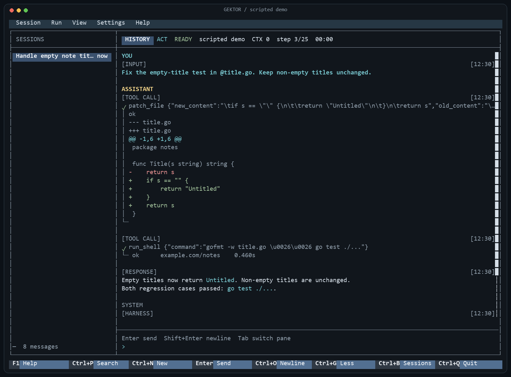

# GEKTOR

A terminal coding agent, written in Go. Bring your model server; GEKTOR supplies
the tool loop, workspace access, session history and terminal UI.

I'm building GEKTOR to keep the agent understandable: one execution loop,
explicit tools and a codebase I can reason about. The focus is coding work
in a repository, with local inference as the starting point.




## What it does

- **Plan and Act.** Explore with read-only tools, then switch to execution.
- **Work with code.** Search, read, patch and move files; run commands and
  manage background processes. Inspect Git changes, stage selected paths and
  make requested commits. Delegate a bounded subtask when useful.
- **Show the work.** Stream answers and reasoning when the backend exposes
  them. Inspect tool arguments, results, diffs and permission requests.
- **Keep sessions.** Reopen and search conversations, continue interrupted
  work, or fork a task. Context compaction keeps the full conversation archive.
- **Extend through files and tools.** Read project `AGENTS.md` instructions
  and task-specific skills. Query OS, hardware and PATH tools on demand.
  Connect external tools over MCP, including an optional
  [browser for UI checks](docs/browser.md) (`-browser chrome` or `-browser msedge`).
- **Use the same loop outside the TUI.** One-shot CLI, JSONL events and a
  stdio integration protocol are included.

GEKTOR connects to **llama.cpp**, **KoboldCPP**, and **OpenAI-compatible APIs**.
Models, weights and inference servers are supplied separately. The Go binary
builds without cgo; Windows is the primary development platform, with Windows
and Linux checks configured in CI.

## Start with a local model

Download a Windows or Linux archive from [Releases](https://github.com/keshon/gektor/releases)
and extract it completely. Windows packages include `run-tui.cmd`, backend
launchers and `.env.example`. Copy `.env.example` to `.env` to configure the
backend launchers, or connect to an existing server through Settings → Model.
The packaged binary does not require Go. On Linux, run `./gektor -tui`.

To build from source, install **Go 1.26.10+**. A running model server capable
of following tool instructions is required either way. These commands assume
llama.cpp at `127.0.0.1:8080`.

```powershell
git clone https://github.com/keshon/gektor.git
cd gektor
go build -o gektor.exe ./cmd/gektor
.\gektor.exe -tui -backend-kind llama -backend http://127.0.0.1:8080 -workspace "D:\path\to\project"
```

On Linux, build with `go build -o gektor ./cmd/gektor` and launch `./gektor`
with the same flags and your workspace path.

The binary connects to an existing server. On Windows, the optional
`run-server-llama.cmd` helper starts one using `LLAMA_SERVER_EXE` and
`LLAMA_MODEL` from a gitignored `.env` file; copy `.env.example` to get started.
`run-tui.cmd` launches the TUI with saved settings; source checkouts rebuild first.

In the UI:

- **Enter** sends; **Ctrl+O** adds a line; **Esc** stops a running turn.
- **F5** switches Plan/Act while idle. **Ctrl+G** expands thinking and tool details.
- **Ctrl+P** opens saved sessions and searches their names and history.
- Type **`/`** for commands or **`@`** to attach a workspace file.
- **Settings → Model** changes the connection. **F1** opens help.

Text attachments work without vision. Image attachments require a supported
vision-capable backend. On such a backend the agent can also read a workspace
picture itself with `read_file`, so a screenshot named in a task does not have
to be attached first. See the [terminal guide](docs/tui.md) for details.

## Run a task from the CLI

Specify the backend explicitly: the standalone CLI's legacy default is
KoboldCPP on port 5001, while the TUI's first-run connection is llama.cpp on 8080.

```powershell
.\gektor.exe -backend-kind llama -backend http://127.0.0.1:8080 -workspace "D:\path\to\project" -verify-cmd "go test ./..." "Fix the failing title test"
```

`-plan` selects read-only planning. `-mode json` emits JSONL events.
`-verify-cmd` runs a final command once and records its result; failure fails
the run without silently starting another model turn. The default step budget
is 25; explicit `-max-steps 0` removes the limit for the main agent.

For a hosted OpenAI-compatible API, use `-backend-kind openai`, its API-root
URL, and `-model`. Supply credentials through an environment variable such as
`GEKTOR_API_KEY` rather than putting a key on the command line. Local-server
context detection takes precedence over a manual limit; hosted endpoints may
need `-context-limit` set explicitly.

[CLI reference](docs/cli.md) · [stdio protocol](docs/rpc.md) ·
[setup and service ownership](docs/bootstrap.md)

## History and instructions

Submitted input and completed steps are saved under the user's `.gektor/`
directory. Existing installations reuse `~/.tars` when `~/.gektor` is absent;
no session data is moved. `GEKTOR_API_KEY` replaces `TARS_API_KEY`, which remains
accepted for existing setups. `-resume` accepts a session directory or its `state.json` file;
`-fork` continues a copy under a new task ID. Compaction reduces the model's
working context while preserving the full archive. Automatic compaction makes
a bounded LLM checkpoint and retains user instructions verbatim alongside
recent messages. An invalid checkpoint leaves the previous context intact.
`/compact` performs a fast extractive pass; `read_history` recovers original
messages from saved sessions.

Ancestor and workspace `AGENTS.md` files are loaded into the agent's
instructions; nested instructions are delivered before file mutations.
A compact catalog advertises workspace [`skills/`](skills/README.md);
full guides are read through visible tool calls when relevant. They belong to the task workspace; running GEKTOR from this
checkout does not install them into another project.

Large tool results can be paged with `read_output` using a session-local ID.
Logs retain at most 16 MiB per output and 128 MiB per session, expire after
seven days, and explicitly report storage limits. Background completions enter
the next model turn; `wait_background` waits for finite jobs without polling.
Completions after a run ends wait for the next run.

In the TUI, `SYSTEM` shows harness messages queued for or included in a model
request, including their actual role and request number. Local interface
notifications use `STATUS`. Hiding SYSTEM only changes the display.

## Current limits

Model quality and tool-call reliability depend on the model and its server.
Streaming and prompt-processing telemetry also depend on what the backend
exposes; KoboldCPP uses non-streaming replies.

GEKTOR is **not a process sandbox**. Built-in file tools use `os.Root` to confine
access to the workspace, including symlink and junction traversal checks. Shell,
Git and external MCP processes run with your account's permissions. Use a container or VM when isolation matters. There is no automatic
workspace backup or rollback. See [SECURITY.md](SECURITY.md).

## Develop and evaluate

```text
go test -race ./...
go vet ./...
go build ./...
go run ./cmd/eval -dry
```

The dry run validates probe definitions without model calls. Live evaluations
run tasks in throwaway fixture workspaces and check files, tool usage and the
answer. See the [eval guide](eval/README.md) for setup, scoring and model-backed
runs. On Windows, `build.cmd check` runs the local checks together.

Experimental TUI `/eval` reviews an archived execution in a separate context,
including history hidden by compaction. It reports evidence-linked findings and
can save narrow project observations as a workspace skill. This is a model
retrospective, not a benchmark score or independent proof of correctness.
See [session retrospective](docs/tui.md#experimental-session-retrospective).

[Architecture](ARCHITECTURE.md) · [conventions](docs/conventions.md) ·
[documentation index](docs/README.md)

## License

[MIT](LICENSE).
