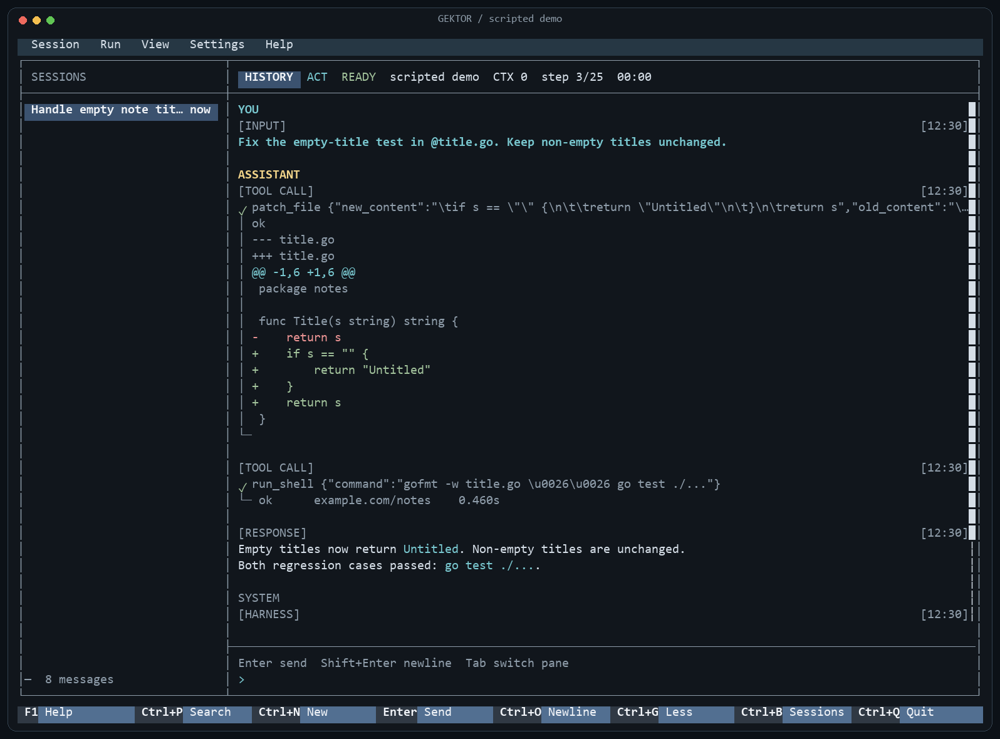

# GEKTOR

A terminal app written in Go for working with models and saved workflows.
In Agent mode, it searches and edits files, runs commands, and saves
conversations you can continue later. In Workflows, you connect steps,
run them with inputs, and inspect the results.
Local models use a server you start separately; a ChatGPT account connection
is also available.



## Quick start

Start a model server separately. GEKTOR defaults to **llama.cpp at
`http://127.0.0.1:8080`**. The model must support tool calls.

Download and extract a [release](https://github.com/keshon/gektor/releases).
On Windows, run `start-gektor-agent.cmd`. On Linux:

```sh
./gektor -tui
```

Open **Settings**, then **Model**, to change the connection. Saved settings are reused.
To select a workspace and server explicitly:

```powershell
.\gektor.exe -tui -workspace "D:\path\to\project" -backend http://127.0.0.1:9931
```

Release binaries need no Go installation. To build from source, install
Go 1.26.10+ and run `go build -o gektor.exe ./cmd/gektor`.
On Linux, use `-o gektor`.

## Choose how to work

Use **Agent** for a conversation where the model chooses its next steps.
Use **Workflows** for saved steps you can run again with different inputs.
The [terminal guide](docs/tui.md) explains both, from opening a project to
reading the result.

Windows launchers use the same naming rule:

| Script | What it does |
|---|---|
| `start-gektor-agent.cmd` | Open Agent in the TUI |
| `start-gektor-workflows.cmd` | Open Workflows in the TUI |
| `run-gektor-agent.cmd` | Run one Agent task in the CLI |
| `run-gektor-workflow.cmd` | Run a saved recipe once |
| `serve-gektor-workflows.cmd` | Run the background workflow worker |

The TUI launchers use saved settings. To select ChatGPT explicitly, run
`start-gektor-agent.cmd -profile profiles/chatgpt.json` after signing in with
`gektor.exe auth login`. Browser access is optional: add `-browser chrome`.
See [launcher examples](scripts/README.md) and
[working demos](demos/README.md).

Workflow recipes are workspace files. Each run has its own saved results.
Most workflow operations do not need a model; AI changes and model-generation
steps do. [Workflow reference and examples](docs/workflows.md).

## Working with code

- **Plan / Act:** inspect the project with read-only tools, then switch to execution.
- **Tools:** search, read, patch and move files; run commands and manage background
  processes; inspect Git changes, stage files and make requested commits.
- **History:** stream answers and reasoning when supported, inspect tool results,
  reopen sessions and continue interrupted tasks. Compaction preserves the full archive.
- **Project guidance:** load `AGENTS.md` instructions and discover workspace skills.
- **Learning (experimental):** `/learn` proposes one reusable lesson from a completed
  task. Save, edit or skip it; `/learn undo` disables the latest save.
  [How learning works](docs/tui.md#learning-from-a-task).
- **Browser:** connect Playwright MCP on demand for page interactions, console checks
  and screenshots. Add `-browser chrome` or `-browser msedge` to make it
  available. [Setup and requirements](docs/browser.md).

Enter sends, Ctrl+O inserts a newline, Esc stops a running turn.
F5 switches Plan/Act, Ctrl+P opens sessions, F1 opens help.
Use `@` to attach workspace files and `/` to see commands.

For a single CLI task:

```powershell
.\gektor.exe -workspace "D:\path\to\project" -verify-cmd "go test ./..." "Fix the failing test"
```

`-verify-cmd` runs once after the agent finishes and records the result.
A failed check fails the run without starting another model turn.
Put flags before the task text.

## Servers and limits

llama.cpp is the default backend. OpenAI-compatible APIs and KoboldCPP are also
supported, including streamed replies. GEKTOR does not install, launch or
manage inference servers or model weights. [Connection and authentication](docs/cli.md).

Browser DOM checks work with text-only models. Inspecting image contents requires
a vision-capable model and backend.

**Shell, Git and MCP tools run with your account's permissions.** Built-in file
tools confine access to the workspace through `os.Root`; `load_skill` also reads
configured skill packages. This does not isolate
processes or network access. There is no automatic workspace backup or rollback.
Keep projects in Git and review changes. [Security boundary](SECURITY.md).

This is experimental software. Task completion and tool-call reliability depend
on the model, server configuration and task. The repository includes
[repeatable eval scenarios](eval/README.md).

## Documentation and development

[Terminal guide](docs/tui.md) · [CLI reference](docs/cli.md) ·
[Setup and saved data](docs/bootstrap.md) · [Architecture](ARCHITECTURE.md) ·
[All documentation](docs/README.md)

```sh
go test -race ./...
go vet ./...
go run ./cmd/eval -dry
```

On Windows, `build.cmd check` runs the local checks. Other development and
CLI helper scripts live in `scripts/`. [MIT license](LICENSE).
