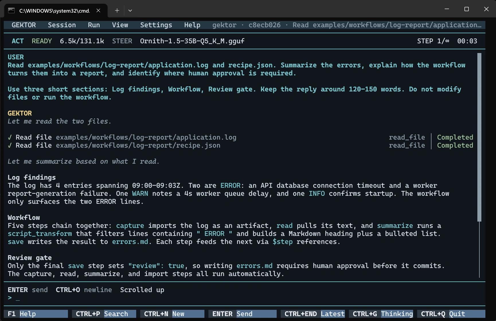

# GEKTOR

GEKTOR is a terminal app for working on code with an AI agent and running saved
workflows. Agent can read and edit project files, run commands, and use a browser
when configured. Workflows run steps you define and keep a record of their results.

Connect a local model server, an OpenAI-compatible API, or an eligible ChatGPT
account. Workflows without model steps need no connection.

## Get started

Download and extract a [Windows or Linux release](https://github.com/keshon/gektor/releases).
On Windows, run `start-gektor-agent.cmd`. On Linux, run `./gektor -tui`.
Release binaries need no Go installation.

Follow [Get started](docs/start.md) to select a workspace and run your first
Agent task, or try a saved workflow without a model.

- [Work with Agent](docs/guide/agent.md): plan, edit, inspect results and retry.
- [Run a workflow](docs/guide/workflows.md): open a recipe and review its results.
- [Connect a model](docs/guide/models.md): local servers, APIs and ChatGPT.
- [Workflow examples](examples/workflows/README.md): recipes with requirements and run instructions.
- [Documentation](docs/README.md): guides, reference and contributor material.

## Permissions and verification

Plan allows read-only tools. Act allows changes under the current permission rules.
Shell commands and external tools run with your account's permissions; the
workspace is not a sandbox for them. Read the [permission guide](docs/guide/permissions.md)
and [security policy](SECURITY.md) before granting sensitive access.

Review diffs and test results after a task. A successful tool call does not prove
that an entire change works. Browser checks require installed Node.js and Chrome
or Edge; image understanding requires a vision-capable model.

## Development

See [Build and contribute](docs/development/README.md), [Architecture](ARCHITECTURE.md)
and the [eval runner](eval/README.md). The [website](website/README.md) publishes
these documentation sources alongside the landing page.

[MIT license](LICENSE).
