# TUI mockups

Open [gektor-ui.figcraft](gektor-ui.figcraft) in FigCraft. This is the editable
project; text, shapes, components, variables and prototype links are native
layers. The `.figcraft` format is FigCraft's native format. Its `.fig` export
is experimental, so it is not the source file here.

These screens are an editable design reference. Editing the project does not
change the running TUI.
The [design reference](../../development/tui.md) defines behavior and the verification
plan. Update it when a reviewed mockup changes an interaction rule.

## Pages

| Page | Contents |
|---|---|
| 00 Start here | Grid, typography, editing notes and review flow |
| 01 Components | 22 reusable components and light/dark state sheets |
| 02 Modal screens | Settings, model picker, MCP, permissions, Theme, sessions, errors, empty results and confirmation |
| 03 Main layouts | Agent and Workflows with aligned inspectors; applied-settings state |
| 04 Narrow and interaction | 40 by 20 layouts and a preserved-draft example |
| 05 Themes | The same controls under the six theme modes |
| 06 Composer review | Queue, received-message and draft states; wide/narrow layouts and a before/after comparison |

The component sheet includes buttons, text inputs, validation, read-only values,
checkboxes, radio choices, list rows, tabs, status, shortcuts, progress and a
multiline editor. Button instances have an editable **Label** property. Other
text layers remain editable in their component or screen.

## Grid and editing

- A terminal cell is represented by 10 pixels horizontally and 20 vertically.
- Text uses Liberation Mono, 16.66 pixels, with a 20-pixel line height. FigCraft
  includes this family; the project does not require a separately installed font.
- Modal screens use 80 by 24 cells. Main layouts use 120 by 40. Narrow checks use
  40 by 20. Keep these frame dimensions while comparing designs.
- Positions and spacing use the cell grid. Each screen has a hidden 10-pixel
  base grid; one text row spans two grid steps. Toggle layout grids to inspect it.
- Borders are editable vector strokes within the border-cell space. Verify
  actual box-drawing glyphs, carets and font metrics in the later TUI preview.
- Edit shared controls through their main components on page 01. Screen buttons
  and state-sheet controls are instances, so shared changes reach their copies.
- Save the native project after editing. Re-export the previews below when their
  screens or palette values change. Keep linked previews as WebP. Put temporary
  exports in `tmp/`. The images are previews, not editable sources.

## Colors

The **TUI palette** variable collection contains semantic color roles. Frames
choose a mode and their nested components inherit it. Change role values there
to explore a palette without repainting every layer.

The theme set is Dark, Light, One Half Dark, One Half Light, Solarized Dark and
Solarized Light. Dark and Light start from GEKTOR's current colors. One Half and
Solarized are adaptations of the terminal-theme references. All six are available
in Settings and through `/theme <name>`. Keep focus, selection,
warning, error and success meanings stable across modes.

Inspector and canvas footers use one text row without blank padding. Their outer
panes stay aligned. The Agent composer has its own height for editable input.

## MCP layout

Keep the searchable table and separate status, tool count and description.
Details, Connect/Disconnect and Edit stay visible. More contains Enable/Disable,
Delete, Add, Paste JSON and Import file. Close appears once in the footer;
the header close target and Escape work too.

The narrow layout keeps server names and status, and hides optional metadata.
Its standalone mockup has more list space than the running Agent screen, which
also reserves rows for its header, composer and hotkey bar. The runtime list
scrolls within the remaining space. These frames show static states; the More
menu and its keyboard and mouse behavior are implemented in the shared table.

## Session workspaces

The **Open session / Dark** and **Open session / Light** boards show a workspace
path on each card, including **Unassigned workspace** for legacy conversations.
The list remains global; Ctrl+F switches between all sessions and the current
workspace. Enter restores the selected session's workspace. An unavailable or
unassigned workspace blocks opening rather than falling back to the current one.
Ctrl+W assigns the current workspace only after a Y/N confirmation; select a
different current workspace under GEKTOR, Change workspace first when relocating a conversation.
These boards show the list state, not an interactive filesystem picker.

`update-session-workspaces.py` generates the corresponding command JSON. The
commands record this migration against the pre-workspace library's node IDs;
they are not a complete project generator and should not be reapplied to the
updated file (the workspace labels already exist).

## Composer and message queue

Page **06 Composer review** records the busy Agent composer and message queue.
The application uses these layouts with the shared toolbar, table and form components.

The summary counts all queued messages and previews only the latest. Click the
count or use ALT+Q, Queue, to open the complete list. At 40 columns the bar
keeps Stop, Send and Queue visible, even when the queue is empty. CTRL+K keeps its text-editing action. The
composer draft stays separate; shortcuts appear once in the bottom bar, with
gaps between groups.

The queue is oldest first. Each row shows its text, state and image count.
Read opens the full selected message and attachment names. Edit opens a separate
editor; Save updates that message in place and Cancel keeps its original content.
The composer draft remains intact. Remove affects only the selected queued
message. Received messages can be read, but cannot be edited or removed.

The implementation uses stable message IDs and checks state atomically for
edit/remove. A queue refresh keeps the selected message. Rows that leave the
inbox remain readable until the window closes, labeled No longer queued unless
receipt was observed. If a message is received during
editing, Save keeps the editor text and explains why it cannot update that entry.
Displayed row numbers indicate order, not identity.

The narrow queue uses two footer rows so Read, Edit, Remove and Close remain
readable. F1 Help and CTRL+O newline remain available in the composer even when
the bar shows Queue. The native components and frames inherit the TUI palette.
Application frames use 80 by 24 or 40 by 20 terminal grids; the comparison and
notes are annotated review boards.

For the click-through, present **Composer / Queued / Light**. Click Queued 3 or
Queue (ALT+Q), then read, edit or remove the selected first message. Save leads
to the edited-list example; Remove leads to the two-message example. The
received-message example has disabled Edit and Remove actions. Other row
selection and text entry are illustrative, not live. Dark and narrow layouts
support queue opening/closing; their detailed flows are not wired.

`update-composer.py` regenerates only this page. It replaces manual edits on
that page when explicitly run. Other pages are preserved. For example:

```text
python docs/design/tui/update-composer.py --output tmp/composer-review.figcraft
```

Use `--cli PATH` if the FigCraft CLI is not installed at the detected location.
Export changed frames with the same `--no-system-fonts` setting.

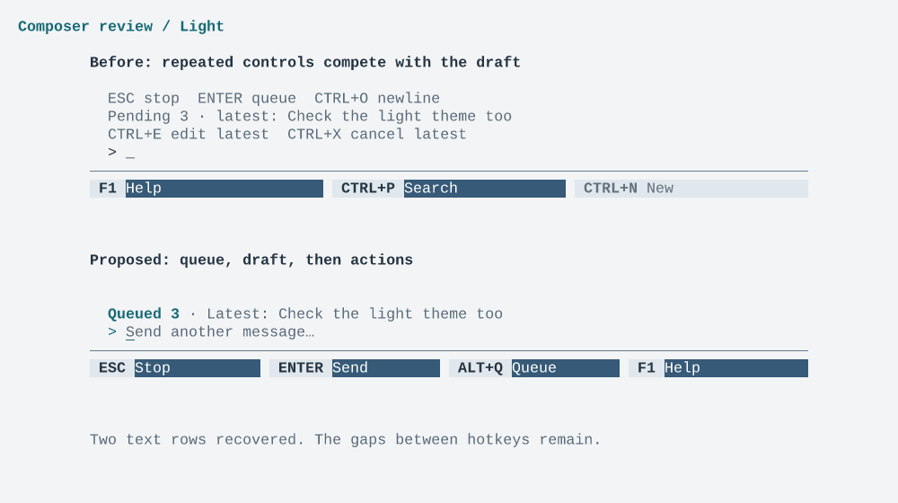

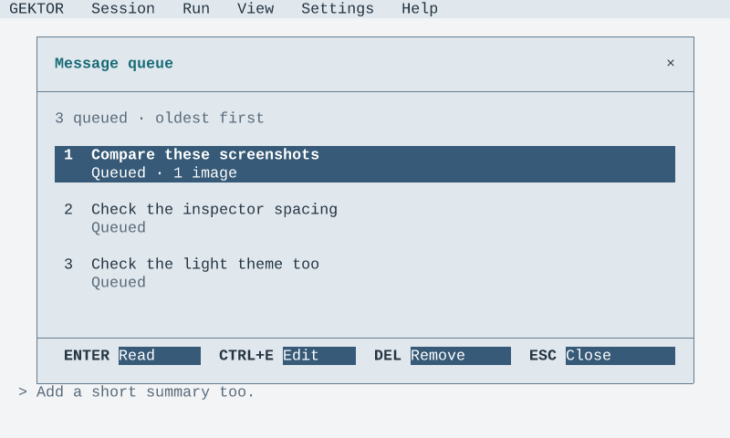

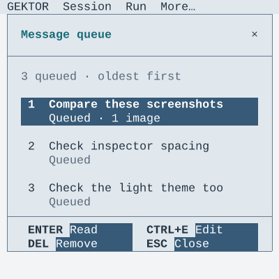

## Click-through review

Start **Settings review / Dark** or **Settings review / Light** in FigCraft's
prototype presenter:

1. Choose Discover to open the model picker.
2. Choose Select to see Settings with Qwen3.8 selected as a pending change.
3. Choose Apply to see the Agent with that model in its header.

Cancel in the picker returns to the unchanged form. Cancel in the changed form
returns to the original Agent state. These links show a visual sequence; typing,
filtering, mouse-wheel behavior, persistence and backend actions are not simulated.
Other controls are static review states unless they have a prototype link.

## Previews

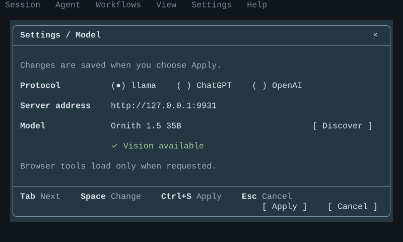

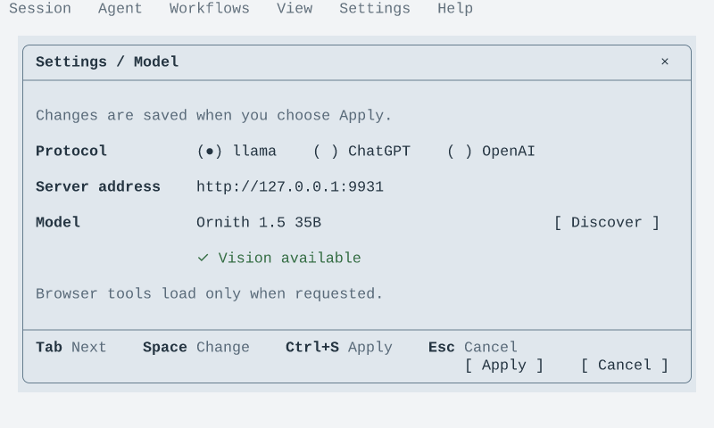

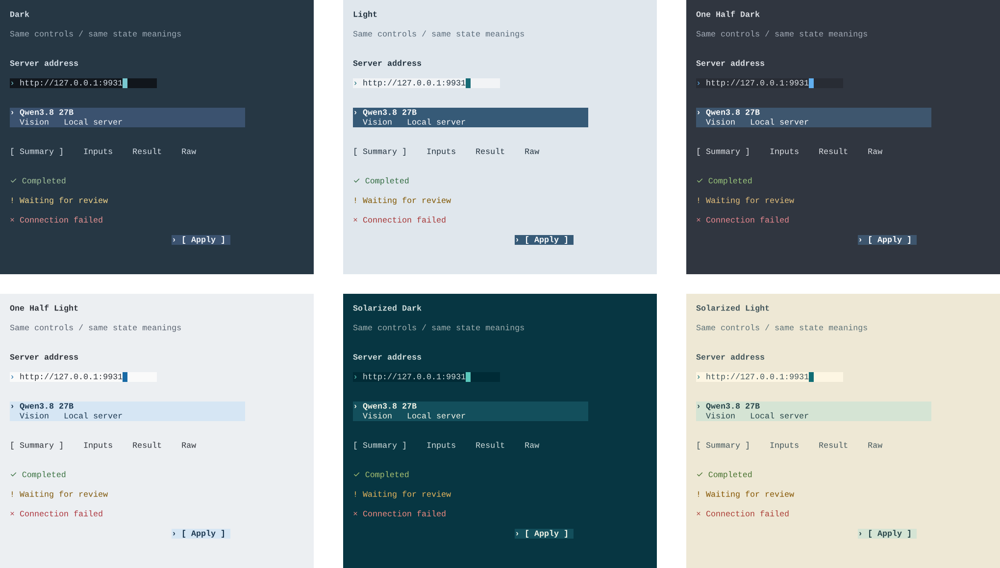

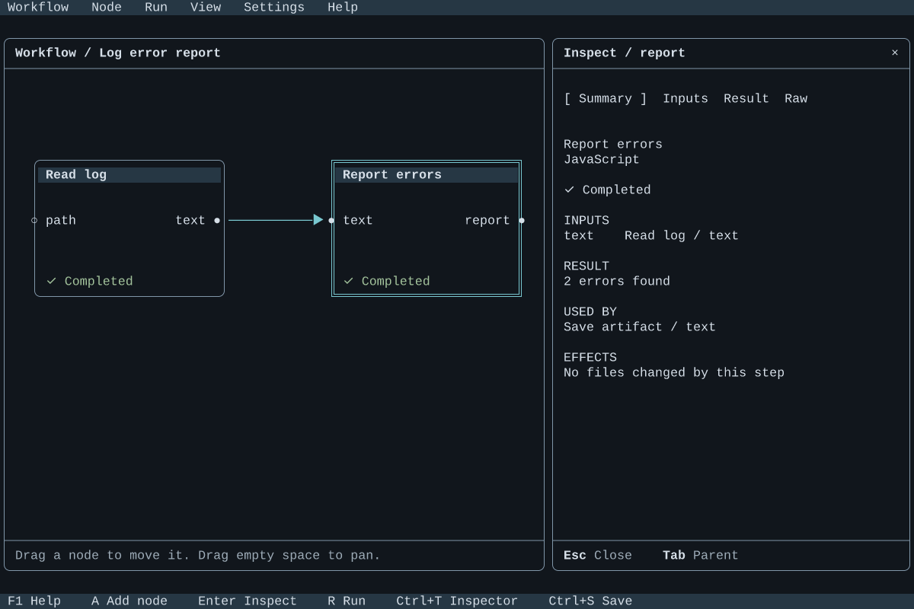

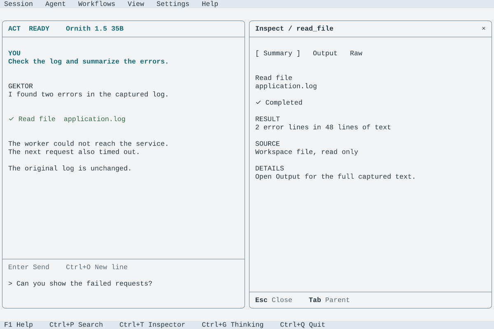

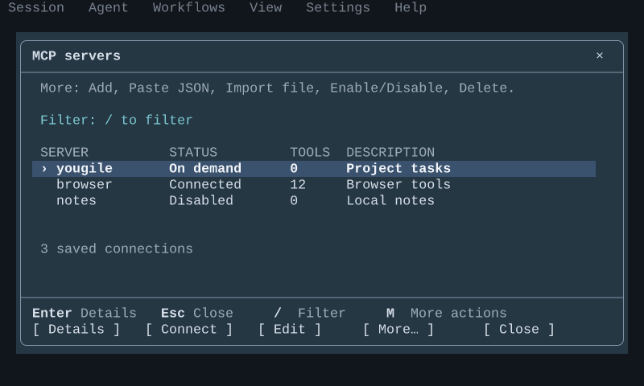

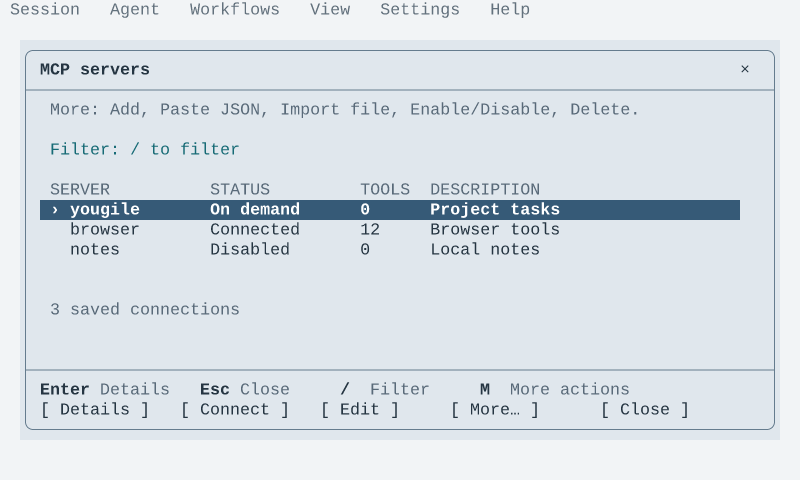

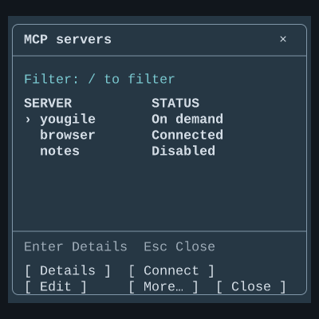

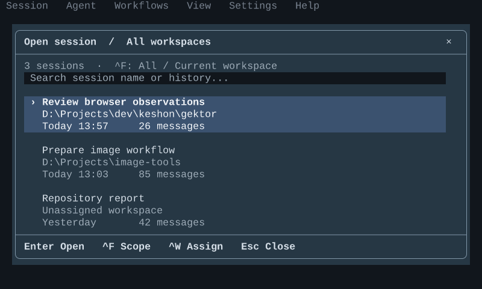

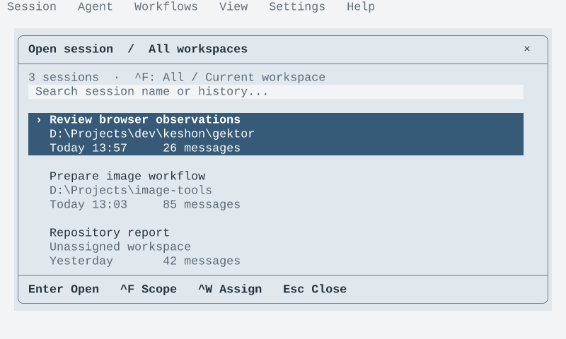
