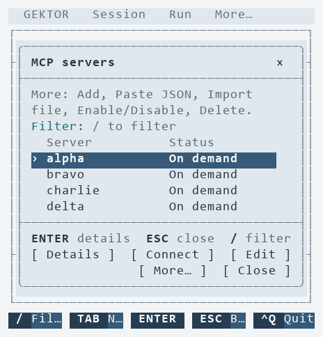

# Audit remediation

Implementation following the [2026-11-20 audit](project-audit-2026-11-20.md),
against the working tree based on `3802e3dac24079ce9bb3ea9855de684b54aefb27`.
The first implementation pass was committed and pushed as `57a7108` on `main`.
The continuation below starts from that clean checkout. This record does not
mark the full product roadmap or public TUI extraction complete.

## Correctness and ownership

| Finding | Implemented behavior | Regression coverage |
|---|---|---|
| B1 | Ordinary model errors retain history, including deadline closing and saved system context | Closing requests and saved archives on successful and failed closing |
| B2 | Background log checks respect the requesting session's output-store ownership | Owner, other session and unscoped operator access |
| B3 | Agent screen shutdown stops admission, cancels event publication and owned work, then waits for cleanup | Finalization barrier, unexecuted commands, worker cancellation and repeated original reproduction |
| B4 | Markdown parsing preserves literal unmatched markers and glob patterns | Literal text, streaming fragments, nested formatting, escaped entities and code whitespace |
| B5 | Failed vision discovery can retry; concurrent callers share an active probe | Failed-then-successful lookup, successful caching and waiter cancellation |

Workflow service operations now return typed results. CLI and tools serialize
those results at their external boundaries; job and TUI callers inspect typed
status. Wire-shape tests retain omitted versus empty values where they differ.

Verification has an explicit persisted receipt: disposition, command, exit code
when available, duration, bounded output and error. A configured command that
never ran is distinct from an absent verifier. Old sessions without receipts
remain unknown. Reports and published outcome events copy mutable values so a
consumer cannot alter the result later persisted by the runtime.

The agent TUI renders trusted receipt fields separately from raw check output.
Log lines such as `outcome:` cannot replace the actual run outcome. Independent
review caught this problem and code wrapping that dropped spaces; both have
regression coverage in the final implementation.

## Chat and small terminals

The agent uses a generic Markdown component with caller-supplied styles,
Goldmark parsing and Chroma highlighting. It renders code, diffs, links, nested
formatting and tables. Unknown languages and large code blocks use plain code
styling. Input terminal controls are removed. Narrow tables become labelled
records; impossible one-cell wide glyphs use an ellipsis.

User prose and ordinary titles use quieter styling. Single-row packed tool
badges remain available, with independent hit targets for inspection. Per-line
and expanded tool layouts remain available as well.

Compact dialogs temporarily use the composer area while preserving its draft.
The 40×20 MCP fixture now shows four server rows, compared with one in the
audit fixture. Keyboard selection and painted mouse rows agree.

These PNGs are approximate renderings of ANSI test fixtures, not native terminal
screenshots. The conversation is synthetic presentation data, not evidence of
a successful model coding task. Font fallback, interactive terminal feel and
Linux visual parity still need native checks. The adjacent ANSI files and
Windows/Pillow rendering script retain the preview inputs.

## Reuse proof

The [workbench example](../../examples/workbench/README.md) is an unrelated,
in-memory reading list. It uses the same list/detail/edit controls, Markdown,
independent palettes, validation and cancellable asynchronous refresh. It imports
no GEKTOR agent, role, session, settings or workflow packages. Tests cover input,
small terminals, cancellation, stale results and shutdown through Bubble Tea.

This remains an internal example. The continuation adds opaque identity and
control-owned input routing for the workbench, with detail refresh preserving
scroll across resize/theme changes. GEKTOR's evaluation dialog also uses opaque
identity and rejects stale progress/completion before lifecycle events drain.
Other GEKTOR callers still use mutable dialog/form/table state. Removing that
legacy surface remains a gate before a stable public package is promised.

The subsequent TUI pass migrated retained dialog identity throughout GEKTOR's parent
shell, Agent and Workflow screens. Queue/return maps, process replies, settings,
tool inspectors, proposal forms and permission requests use opaque IDs. Events
no longer expose `DialogState`; pointer-based completion/resume helpers are
private. Guarded table updates copy rows/actions and retain selection/filter;
secret submission consumes only the matching current overlay. Suspended drafts
can resume only once in their owning controls and retain focus/text. Tests cover
late events arriving before replacement lifecycle events drain.

`identity.go` was removed: dialog identity and refresh belong to `dialogs.go`,
completion and resumption to `events.go`, input routing to
`dialog_controls.go`, and secret access to `secret.go`. Settings still accesses
its editable draft and layout state, and features retain table models for
navigation between overlays. The entire control state is not yet private.

## Evaluation evidence

Eval results retain check specifications, verdicts, bounded output, timing and
exit evidence. Summary-writing failures return through cleanup. The opt-in
`-max-failures` gate returns 1 when failures exceed the allowance and 2 for
infrastructure errors or no scored runs; exploratory mode remains the default.

The browser-unavailable probe now checks structured facts about the actual
import-map key and unresolved bare import. It requires browser execution and
calculator behavior to remain unverified. This changes the probe fingerprint;
old results are not interchangeable with the revised experiment.

One live run used the supplied llama.cpp endpoint and Ornith model. It timed
out after 180.1 seconds and three steps. The gate correctly returned failure.
This establishes neither a successful factual response nor improved model
performance. Its [summary](remediation-2026-11-20/browser-summary.json),
[results](remediation-2026-11-20/browser-results.jsonl) and
[metadata](remediation-2026-11-20/browser-meta.json) are retained. The run began
before the final review fixes; its metadata describes that invocation.

## Validation

Windows amd64 validation after implementation:

- `go test -p 1 ./...`: passed.
- `go test -race -p 1 ./...`: passed; no race detector reports.
- `go vet ./...`: passed.
- Focused final Markdown, receipt and visual-fixture tests: passed.
- `go run ./cmd/eval -dry`: all 45 definitions valid.
- Website documentation check: passed, 72 files and 35 articles.
- `govulncheck@v1.10.0 ./...`: no reachable or imported-package vulnerabilities;
  the existing unimported `golang.org/x/crypto/openpgp` advisory remains.
- `go build -o bin/gektor.exe ./cmd/gektor`: passed.

The first integrated test attempt found example documentation path errors and
a concurrent-edit compile failure while the report clone was being added.
Both were corrected before the successful full run.

## Remaining gates

1. Native terminal review was waived by the user on 2026-11-20. The automated
   96-frame matrix passes; native input, fonts and cross-platform parity remain
   unverified. No manual review is required for this continuation.
2. Dialog/form encapsulation is complete for production and integration tests.
   Active dialog, form, table and secret state are private to controls; hosts
   use copied snapshots, input and lifetime-checked operations. The isolated
   candidate and separate workbench consumer pass without application imports.
3. Resume GEKTOR-only tool/context experiments if changing defaults. Eighteen
   paired simple-task runs and one baseline ledger run passed; the ledger pair
   was interrupted when the user returned work to the TUI. Context-policy and
   recovery coverage remain incomplete. Competitor testing was dropped.
4. Public packages now live under `pkg/tui` in GEKTOR's root module. Verify a
   consumer pinned to an actual GEKTOR release before claiming released-version
   compatibility. Extend platform release smoke coverage separately.
5. Continue the audit's composition and observability ownership cleanup where
   concrete callers justify it; avoid a repository-wide rewrite.

No controlled Pi/OpenCode solve-rate comparison has been completed. The packed
tool layout is preserved as a GEKTOR design preference; uniqueness is not claimed.

## Continuation acceptance record

The workbench now uses `DialogID`, `DialogInput`, identity-checked information
refresh and form completion without reading `DialogState`. Tests cover retained
detail lifetime/scroll and form focus/drafts, cancellation and replaced jobs.
The GEKTOR evaluation consumer supplies a second identity-sensitive caller;
late results cannot replace a different dialog. This is an internal migration
step, not complete encapsulation of every GEKTOR control consumer.

The automated acceptance matrix adds inspection, permission, rejection note,
queue/editor and workflow graph/inspector/failure/review/permission views at all
three sizes in dark/light themes. Chat fixtures click each packed badge's
independent target. These tests exposed a 40×20 long permission prompt losing
its first context line; the compact gate now retains that line instead of
substituting a generic truncation notice.

The matrix contains 96 deterministic frames: 36 chat, 30 agent interaction and
30 workflow frames. It checks cell geometry, visible context and model-level
hit routing; it does not check delivery by a native terminal. Set
`GEKTOR_TUI_PREVIEW_DIR` when running the presentation tests to export ANSI.

The [controlled comparison protocol](controlled-comparison-2026-11-20.md) and
preflight script freeze fixture hashes and plan 36 unexecuted runs across the
three pinned checkouts. The backend refused connections; no solver ran and no
profile or performance improvement is established. Settings verification,
client adapters and the remaining fixture categories are still required.

The server was subsequently restored. A GEKTOR-only comparison used the same
built runner, Ornith 1.5 35B Q5_K_M weights, server and fixtures, with alternating
baseline/lazy-web order, context 131072 and response limit 8192. All 18 completed
exact-edit, ambiguous-edit and nested-skill runs passed (three repeats per arm
and case). One baseline ledger repair also passed the hidden acceptance check
in 322.9 seconds and 11 steps. The user then switched work back to the TUI:
the active lazy-web ledger run was interrupted and four later ledger runs were
not started. The ledger comparison is incomplete. The retained
[results and invocation metadata](remediation-2026-11-20/profile-results.json)
include model/server hashes and settings. Full traces remain under
`eval/results/remediation-live-20261120/` in this checkout.

`-tool-profile lazy-web` is an opt-in eval input that makes the four native web
tools discoverable instead of initially eager; it changes no shipping default
or permission rule. Cache state carried across alternating arms. Smaller initial
prompts alone establish neither a speed nor a reliability improvement. Smaller
context, long-context retrieval, cancellation/resume and unavailable-tool profile
experiments remain unproved. At the user's direction, further Pi/OpenCode testing
is outside the continuation scope; no three-product ranking is claimed.

Native terminal review was waived by the user on 2026-11-20. Automated screen messages and ANSI
fixtures do not establish terminal font fallback, real mouse behavior or Linux
parity. The available Windows computer-use workflow prohibits terminal-app
automation, so no native review is claimed for this continuation.

For native acceptance, record the OS, terminal/version, font, exact commit and
theme with each result. Repeat the following at 40×20, 80×24 and 120×40 in both
dark and light theme families. Record failures and retained evidence before
marking a cell complete; resizing one inspected view does not accept the others.

| Surface | Native acceptance action | Status |
|---|---|---|
| Chat | Read prose, literal globs, code, diff, table and long history; resize while scrolled | Not run; waived |
| Streaming | Observe partial Markdown, stop a response, then continue; retain all received text | Not run; waived |
| Tools | Keep packed badges; inspect each adjacent badge with keyboard and mouse; close and restore transcript position | Not run; waived |
| Permissions | Inspect requested action/resource; allow and deny separate harmless fixture requests; cancel and quit while pending | Not run; waived |
| Queue | Add two messages during a run; edit one, cancel its edit, remove the other; confirm draft and ordering | Not run; waived |
| Workflow | Open canvas and inspector, edit a draft, run a harmless fixture, deny a permission and cancel; inspect persisted status | Not run; waived |
| Workbench | Scroll detail, resize and switch palette; edit and cancel; replace a refresh and quit while it is pending | Not run; waived |

The isolated [scripted TUI smoke check](../development/testing.md#native-interaction-review-with-a-scripted-backend)
provides a temporary home and deterministic streaming, adjacent tool calls,
harmless permission requests and a local workflow fixture. The documented
manual checklist has not been executed. Automated backend tests and building
the helper do not count as this native matrix passing.

Public package extraction and distribution remain deferred until the remaining
public-state ownership work and a pinned external-consumer build pass. Native
review was waived; further controlled model comparisons are outside the current
TUI scope and are required only before changing model/tool defaults. There is no
new public module, version promise or pinned external-consumer build in this
continuation.

Continuation validation on Windows amd64:

- `go test -p 1 ./...`: passed; affected TUI/workbench packages reran after the final edits.
- `go test -race -p 1 ./internal/tui/... ./examples/workbench`: passed.
- `go test -race -p 1 ./...`: passed; no race detector reports.
- `go vet ./...`: passed.
- `go run ./cmd/eval -dry`: all 45 definitions valid.
- `node website/scripts/check-docs.mjs`: passed, 72 files and 35 articles.
- `go build -o bin/gektor.exe ./cmd/gektor`: passed.
- Comparison preflight: fixture hashes and 36 planned runs validated; reused output directories rejected. No solver executed.

After the subsequent TUI identity migration and eval-profile addition:

- `go test -p 1 ./...`: passed.
- `go test -race -p 1 ./internal/tui/... ./examples/workbench ./cmd/eval`: passed.
- `go vet ./...` and the native executable build: passed.
- Dry eval validation, documentation path/anchor checks and `git diff --check`: passed.
- The first integrated identity-event check found two remaining pointer-based
  test references; both were converted before the passing runs. Native terminal
  acceptance remains pending, and public extraction is still deferred.

## TUI ownership continuation after `ace9dc1`

Settings policy now consumes copied field snapshots and returns presentation
configuration. Controls retain the editor and picker; configuring unchanged
values preserves the cursor and focus. Form creation no longer returns a mutable
widget. Appearance configuration is supplied with the form request. Discovery
requests capture values and cancellation contexts, are admitted once per picker,
and are cancelled when the picker or dialog closes or is replaced. Stale results
cannot update a replacement form.

Retained table widgets are private to controls. The shell, Agent, Workflow and
workbench retain owner-bound `TableID` handles and supply copied rows. Tests cover
filter, selection, focus and scroll across detail/edit returns, foreign handles,
snapshot isolation and stale updates. Workbench remains the boundary exercise;
some dialog/form presentation state is still exposed, so no public extraction
or complete encapsulation is claimed. Packed chat badges are unchanged.

The smoke helper now supplies delayed cancellable streaming, two adjacent tool
calls, allow/deny fixtures and a local workflow returning 3 from input 2. Its
protocol, permission and workflow tests run without a model server. Native
terminal review remains pending at the matrix sizes above in both theme families.

Validation for this ownership continuation on Windows amd64:

- Full normal and race suites: `go test -p 1 ./...` and `go test -race -p 1 ./...` passed.
- The TUI/workbench normal suite reran successfully after final source cleanup.
- `go vet ./...`, the native executable build and all 45 dry eval definitions passed.
- Explicit smoke-helper race tests and vet passed.
- Documentation path/anchor checks and `git diff --check` passed.
- An integrated vet attempt exposed an older copy of the shared control-state
  file; the intended ID-only events and private table model were restored before
  the passing checks. Native terminal acceptance remains unperformed.

### Production dialog access

After the table/settings ownership commit, production screens were migrated off
direct `Controls.Dialog` access. They now read value-only `DialogInfo`, request
controls-owned status shortcuts and use lifetime-checked form focus. Help mode
and its title are supplied in the dialog request rather than mutated afterward.
No production consumer outside `screen` retains or directly edits a dialog/form
widget. Existing internal tests still inspect public control state; removing
that exported surface and moving those fixtures onto supported operations remain
part of any public extraction. This change does not establish native acceptance.

Validation: the TUI/workbench normal and race suites passed, including help/menu
fixtures and copied metadata/shortcut lifetime checks. `go vet ./...`, the
executable build and documentation checks passed. Packed badge behavior and
shipping model/tool defaults are unchanged.

### Native-review waiver and package preparation

The user declined manual terminal testing and asked to skip it and move forward
on 2026-11-20. This waives that acceptance gate for the continuation; it does not
convert unperformed checks into passes. Earlier pending-native-review statements
above describe the state before this decision. No manual test is requested.

`scripts/check-tui-package.go` prepares an unpublished candidate in a temporary
module and the workbench in a separate consumer module. It rejects imports of
GEKTOR application packages, rewrites only the internal control import prefix,
then tidies dependencies, tests, vets and builds both modules. The consumer uses a local
replacement of the candidate; this proves a separate build without repository
`internal` access, not compatibility with a published or pinned release. Source
files are hashed before rewriting. The repository module and shipping imports
are not changed, and no package is published.

The isolated candidate and consumer checks passed on Windows amd64. Candidate
source SHA-256 before import rewriting was
`e8ea78ec71deb0c945e59d5a97447ceb7189dd2a527527425c535fb52aabea47`.
The import-boundary guard tests, script vet and documentation checks also passed.
Public-state cleanup and a real pinned release consumer remain outstanding.

### Private dialog state and integration coverage

`Controls` no longer exposes its active dialog, and dialog/form/table/secret
state types are private to `screen`. Integration tests in the shell, Agent,
Workflow and tools now read detached snapshots and edit using routed input or
declarative fixtures. Retained identities use `DialogID`; no mutable test
accessor was added. Focus, picker opening and copied choices are guarded by the
current form identity. Dialog content, choice lists, picker results and table
actions are copied before being returned. Scan results also copy their input
items so an effect cannot mutate accepted picker contents afterward.

The previously outstanding exported dialog-state cleanup is complete. Earlier
notes about tests retaining widget pointers describe the pre-migration state.
Native review remains waived, and no new model experiment or performance claim
is part of this change. A public module name/layout, versioned distribution and
a consumer pinned to that actual release remain separate work; the temporary
package check uses a local replacement and does not publish anything.

Validation for the private-state migration:

- `go test -p 1 ./...`: passed.
- `go test -race -p 1 ./internal/tui/... ./examples/workbench`: passed.
- Final snapshot isolation/lifetime tests passed with the race detector.
- `go vet ./...` and the native executable build: passed.
- Isolated candidate and separate workbench consumer tests, vet and builds: passed.
  Input source SHA-256:
  `b848418e5fbc077d4cdda962aa2faca4d58c54b4985394ee884547d157fd5ce9`.
- Documentation links/anchors and `git diff --check`: passed.

### Public packages in the root module

The user chose the Melodix layout: reusable code stays in this repository under
`pkg/tui`, with one root `go.mod` and versions following GEKTOR. Controls moved
from `internal/tui/screen` to `pkg/tui/screen`; components moved from
`internal/tui/components` to `pkg/tui/components`; the workbench moved to
`pkg/tui/examples/workbench`. Application screens, settings, tools, clipboard and
terminal runtime remain under `internal/tui`. There are no compatibility wrappers
or nested modules. Earlier notes about choosing a standalone module are superseded.

The separate-consumer checker now copies only the public package sources into a
snapshot of the real root module. The external workbench imports
`github.com/keshon/gektor/pkg/tui/...` unchanged and uses a local replacement for
GEKTOR. Public-package import checks include tests and examples; they reject
application dependencies. This verifies the current source layout, not a
published version. No tag, release or distribution artifact is published.

The package README documents imports, ownership and the workbench. Both sections
were edited with the humanizer skill; code blocks and link targets were retained.
Native terminal review remains waived, and packed tool badges are unchanged.

Validation after the public-package move:

- `go test -p 1 ./...`: passed.
- `go test -race -p 1 ./internal/tui/... ./pkg/tui/...`: passed.
- `go vet ./...`, the executable build and all 45 dry eval definitions: passed.
- The separate consumer passed tests, vet and build with unchanged public imports.
  Public-source SHA-256:
  `166555cf344d11d530c141a9c32c73542c9c0643c8c306734f750e49f0422b5e`.
- Boundary-checker tests and vet, formatting and diff checks: passed.
- Documentation checks: 74 Markdown files and 35 published articles passed.
- The first focused run found the component-boundary test still walking the old
  directory. It moved beside the shared screen tests and passed. A stale example
  index link was also corrected before the passing documentation check.

### Runtime notices and Pixelita completion

The llama.cpp adapter's transient attribution footer repeated the current user
request and mode as another user turn. Its wording matches the notices called
prompt injection in the reported screenshot. The footer is removed. Both wire
adapters now use a stable initial system explanation and JSON runtime envelopes
for internally tagged user-role notices. Saved history retains its original
content and roles. Tool results keep their tool role; compacted context, loaded
context and image attachments remain informational. Text beginning `[harness]`
does not acquire runtime provenance. Directives and approved budget continuation
are tagged at their source. This is covered by request and provenance regressions;
no live model run establishes that warnings have stopped.

Pixelita's original-size optimization could be previewed but had no write tool.
`image_optimize` now publishes that operation through the shared Agent/workflow
contract. `keep` quantizes PNGs or optimizes JPEGs; `webp` converts PNG/JPEG at
original dimensions. `image_variants` remains the resizing operation. Exact output
permissions use the actual operation name. Tests decode real palette PNG and WebP
outputs, check dimensions and source preservation, and exercise direct and workflow
permissions, existing destinations and declined batches. Pixelita can decline an
output under its size/fidelity thresholds. Quality/quantizer controls and explicit
conversion to PNG are not exposed by the pinned public API. No dependency changed.

The pending TUI edits keep a single main pane neutral, show focus color when the
inspector is open, use `❯ ` with a native bar caret, and preserve reasoning styles
on independently drawn wrapped rows. Terminal blink timing remains terminal-owned;
no timing fix or native visual review is claimed. Packed tool badges are unchanged.

A check during implementation found no recurring restore: the moved screen package
matched HEAD, the old internal screen path was absent, and its source hash remained
stable across repeated reads. No recent reset/checkout appeared in the reflog.

Validation for these changes:

- `go test -p 4 ./...`: passed after correcting the eval continuation producer's
  obsolete generic notice tag. Earlier in-flight runs failed during implementation.
- Race tests passed for agent, LLM adapters, roles, image capabilities, image tools,
  tool catalog/policy, workflow agent tools and application composition.
- `go vet ./...`, native executable build and all 45 dry eval definitions: passed.
- Repository documentation conventions, formatting and `git diff --check`: passed.
- No live model comparison, native terminal review, release or publication was run.

### ICC color conversion through Pixelita

The failed Dreamcast image session (`0767a51d`) exposed an Adobe RGB (1998)
profile in the source JPEG. The prior writer path could preserve that profile
only through same-size JPEG Huffman optimization; resize and WebP encoding were
blocked. The native skill also omitted image_optimize and cited recipe version 3.

Pixelita now accepts explicit ColorProfile srgb in its typed optimization API,
canonical CLI and applicable specialist wrappers. It transforms supported RGB
matrix/TRC ICC v2/v4 input/display profiles to sRGB before encoding or resizing.
The default remains preserve. LUT/CMYK profiles, malformed containers and animation
remain rejected. Conversion uses relative colorimetry and channel clipping, with
no black-point compensation. It is a bounded RGB ICC implementation, not general
color management. JPEG Huffman optimization cannot transform colors; use explicit
WebP conversion or a resize for that request. PNG outputs receive an sRGB tag;
old source ICC data is removed only after applying the transform. Fidelity checks
use the transformed reference, and reports include metrics.colorConversion.

GEKTOR exposes color_profile preserve|srgb on image_preview, image_optimize and
image_variants through the shared Agent/workflow schema. Unsupported profile
results block both preview and publication. Recovery distinguishes supported
sRGB normalization from unchanged retries or stripping. Skill guidance now includes
image_optimize and recipe version 4. Original files and output permission rules
remain intact.

The actual session image converted at default thresholds from 2,470,609 to
197,854 bytes (4540 by 2200 pixels, 91.99% gain). Pixelita measured PSNR 46.1479 dB
and SSIM 0.985797 against the sRGB reference. A separate lossless normalized PNG
was compared with Pillow/LittleCMS 2.19 using identical Go-decoded input pixels:
mean absolute channel difference 0.0027252, maximum 1 on the 8-bit scale. This
isolates the color transform from JPEG decoder differences. Source SHA-256 stayed
`d42fe4bf514b7c7c9fc4fbefec0dff08fda1c97b114d97758dafd2d09065fb09`.
These measurements describe this one image; no corpus-wide improvement is claimed.
No blog asset was uploaded or replaced.

GEKTOR pins published Pixelita commit cbc2fde15043 through
`v0.1.1-0.20261120191608-cbc2fde15043`; no local replace or workspace is required.
Pixelita remains on its existing codex/gektor-integration branch. The real-image
GEKTOR contract probe also wrote the 197,854-byte output with exact-path
image_optimize authorization and matching source hashes, using a temporary
workspace rather than changing the blog image.

Validation:

- Pixelita: full normal and race tests, vet and all command builds passed.
  A final byte-helper policy regression passed focused race tests as well.
- GEKTOR: `go test -p 4 ./...` passed using the downloadable dependency.
- GEKTOR image capabilities, tool catalog/policy, workflow tools and app race tests
  passed with the final dependency pin.
- GEKTOR vet, root/bin executable builds and all 45 dry eval definitions passed.
- Documentation conventions, formatting and diff checks passed.
- An earlier temporary Go workspace leaked into eval fixture subprocesses and
  failed their module discovery. The final standalone run has no such override
  and passes. A separate unquoted temporary replace argument failed before
  mutation; no local replacement was retained.
