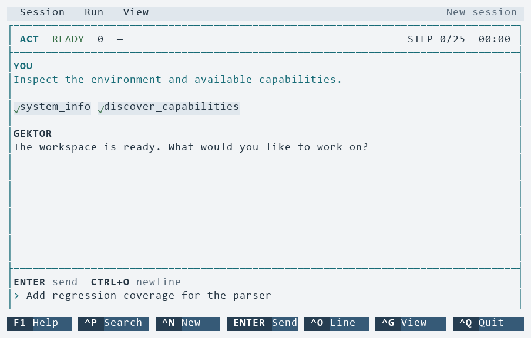

# Audit remediation

Implementation following the [2026-11-20 audit](project-audit-2026-11-20.md),
against the working tree based on `3802e3dac24079ce9bb3ea9855de684b54aefb27`.
This record covers the first implementation pass. It does not mark the full
product roadmap or public TUI extraction complete.

## Correctness and ownership

| Finding | Implemented behavior | Regression coverage |
|---|---|---|
| B1 | Ordinary model errors retain history, including deadline closing and saved system context | Closing requests and saved archives on successful and failed closing |
| B2 | Background log checks respect the requesting session's output-store ownership | Owner, other session and unscoped operator access |
| B3 | Agent screen shutdown stops admission, cancels event publication and owned work, then waits for cleanup | Finalization barrier, unexecuted commands, worker cancellation and repeated original reproduction |
| B4 | Markdown parsing preserves literal unmatched markers and glob patterns | Literal text, streaming fragments, nested formatting, escaped entities and code whitespace |
| B5 | Failed vision discovery can retry; concurrent callers share an active probe | Failed-then-successful lookup, successful caching and waiter cancellation |

Workflow service operations now return typed results. CLI and tools serialize
those results at their external boundaries; job and TUI callers inspect typed
status. Wire-shape tests retain omitted versus empty values where they differ.

Verification has an explicit persisted receipt: disposition, command, exit code
when available, duration, bounded output and error. A configured command that
never ran is distinct from an absent verifier. Old sessions without receipts
remain unknown. Reports and published outcome events copy mutable values so a
consumer cannot alter the result later persisted by the runtime.

The agent TUI renders trusted receipt fields separately from raw check output.
Log lines such as `outcome:` cannot replace the actual run outcome. Independent
review caught this problem and code wrapping that dropped spaces; both have
regression coverage in the final implementation.

## Chat and small terminals

The agent uses a generic Markdown component with caller-supplied styles,
Goldmark parsing and Chroma highlighting. It renders code, diffs, links, nested
formatting and tables. Unknown languages and large code blocks use plain code
styling. Input terminal controls are removed. Narrow tables become labelled
records; impossible one-cell wide glyphs use an ellipsis.

User prose and ordinary titles use quieter styling. Single-row packed tool
badges remain available, with independent hit targets for inspection. Per-line
and expanded tool layouts remain available as well.

Compact dialogs temporarily use the composer area while preserving its draft.
The 40×20 MCP fixture now shows four server rows, compared with one in the
audit fixture. Keyboard selection and painted mouse rows agree.

These PNGs are approximate renderings of ANSI test fixtures, not native terminal
screenshots. The conversation is synthetic presentation data, not evidence of
a successful model coding task. Font fallback, interactive terminal feel and
Linux visual parity still need native checks. The adjacent ANSI files and
Windows/Pillow rendering script retain the preview inputs.

## Reuse proof

The [workbench example](../../examples/workbench/README.md) is an unrelated,
in-memory reading list. It uses the same list/detail/edit controls, Markdown,
independent palettes, validation and cancellable asynchronous refresh. It imports
no GEKTOR agent, role, session, settings or workflow packages. Tests cover input,
small terminals, cancellation, stale results and shutdown through Bubble Tea.

This remains an internal example. The current controls still expose dialog
identity through mutable state, and hosts still route input themselves. Detail
resize/theme changes reopen the view and reset scroll. These are documented
constraints to resolve before a stable public package is promised.

## Evaluation evidence

Eval results retain check specifications, verdicts, bounded output, timing and
exit evidence. Summary-writing failures return through cleanup. The opt-in
`-max-failures` gate returns 1 when failures exceed the allowance and 2 for
infrastructure errors or no scored runs; exploratory mode remains the default.

The browser-unavailable probe now checks structured facts about the actual
import-map key and unresolved bare import. It requires browser execution and
calculator behavior to remain unverified. This changes the probe fingerprint;
old results are not interchangeable with the revised experiment.

One live run used the supplied llama.cpp endpoint and Ornith model. It timed
out after 180.1 seconds and three steps. The gate correctly returned failure.
This establishes neither a successful factual response nor improved model
performance. Its [summary](remediation-2026-11-20/browser-summary.json),
[results](remediation-2026-11-20/browser-results.jsonl) and
[metadata](remediation-2026-11-20/browser-meta.json) are retained. The run began
before the final review fixes; its metadata describes that invocation.

## Validation

Windows amd64 validation after implementation:

- `go test -p 1 ./...`: passed.
- `go test -race -p 1 ./...`: passed; no race detector reports.
- `go vet ./...`: passed.
- Focused final Markdown, receipt and visual-fixture tests: passed.
- `go run ./cmd/eval -dry`: all 45 definitions valid.
- Website documentation check: passed, 72 files and 35 articles.
- `govulncheck@v1.10.0 ./...`: no reachable or imported-package vulnerabilities;
  the existing unimported `golang.org/x/crypto/openpgp` advisory remains.
- `go build -o bin/gektor.exe ./cmd/gektor`: passed.

The first integrated test attempt found example documentation path errors and
a concurrent-edit compile failure while the report clone was being added.
Both were corrected before the successful full run.

## Remaining gates

1. Run controlled, repeated smaller-tool/context-profile experiments on the same
   model and fixtures before changing defaults. The failed live calibration is
   not evidence for such a change.
2. Complete native terminal review and the full visual acceptance matrix,
   including workflow, permission and queue interactions across platforms.
3. Make control identity opaque and reduce mutable host access; preserve focus,
   scroll and async ownership in both consumers before extracting a module.
4. Publish a versioned component API only after an external pinned-version
   consumer builds. Extend platform release smoke coverage separately.
5. Continue the audit's composition and observability ownership cleanup where
   concrete callers justify it; avoid a repository-wide rewrite.

No controlled Pi/OpenCode solve-rate comparison has been completed. The packed
tool layout is preserved as a GEKTOR design preference; uniqueness is not claimed.
