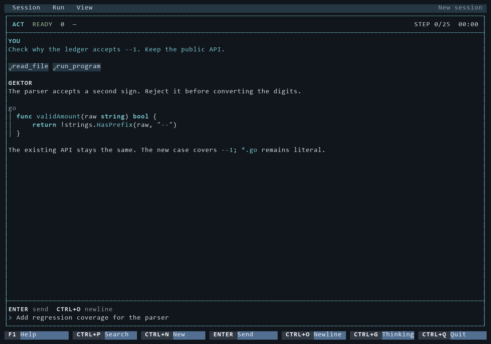
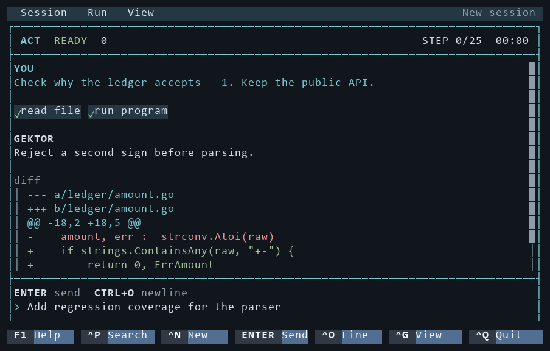

# Audit remediation

Implementation following the [2026-11-20 audit](project-audit-2026-11-20.md),
against the working tree based on `3802e3dac24079ce9bb3ea9855de684b54aefb27`.
The first implementation pass was committed and pushed as `57a7108` on `main`.
The continuation below starts from that clean checkout. This record does not
mark the full product roadmap or public TUI extraction complete.

## Correctness and ownership

| Finding | Implemented behavior | Regression coverage |
|---|---|---|
| B1 | Ordinary model errors retain history, including deadline closing and saved system context | Closing requests and saved archives on successful and failed closing |
| B2 | Background log checks respect the requesting session's output-store ownership | Owner, other session and unscoped operator access |
| B3 | Agent screen shutdown stops admission, cancels event publication and owned work, then waits for cleanup | Finalization barrier, unexecuted commands, worker cancellation and repeated original reproduction |
| B4 | Markdown parsing preserves literal unmatched markers and glob patterns | Literal text, streaming fragments, nested formatting, escaped entities and code whitespace |
| B5 | Failed vision discovery can retry; concurrent callers share an active probe | Failed-then-successful lookup, successful caching and waiter cancellation |

Workflow service operations now return typed results. CLI and tools serialize
those results at their external boundaries; job and TUI callers inspect typed
status. Wire-shape tests retain omitted versus empty values where they differ.

Verification has an explicit persisted receipt: disposition, command, exit code
when available, duration, bounded output and error. A configured command that
never ran is distinct from an absent verifier. Old sessions without receipts
remain unknown. Reports and published outcome events copy mutable values so a
consumer cannot alter the result later persisted by the runtime.

The agent TUI renders trusted receipt fields separately from raw check output.
Log lines such as `outcome:` cannot replace the actual run outcome. Independent
review caught this problem and code wrapping that dropped spaces; both have
regression coverage in the final implementation.

## Chat and small terminals

The agent uses a generic Markdown component with caller-supplied styles,
Goldmark parsing and Chroma highlighting. It renders code, diffs, links, nested
formatting and tables. Unknown languages and large code blocks use plain code
styling. Input terminal controls are removed. Narrow tables become labelled
records; impossible one-cell wide glyphs use an ellipsis.

User prose and ordinary titles use quieter styling. Single-row packed tool
badges remain available, with independent hit targets for inspection. Per-line
and expanded tool layouts remain available as well.

Compact dialogs temporarily use the composer area while preserving its draft.
The 40×20 MCP fixture now shows four server rows, compared with one in the
audit fixture. Keyboard selection and painted mouse rows agree.

These PNGs are approximate renderings of ANSI test fixtures, not native terminal
screenshots. The conversation is synthetic presentation data, not evidence of
a successful model coding task. Font fallback, interactive terminal feel and
Linux visual parity still need native checks. The adjacent ANSI files and
Windows/Pillow rendering script retain the preview inputs.

## Reuse proof

The [workbench example](../../examples/workbench/README.md) is an unrelated,
in-memory reading list. It uses the same list/detail/edit controls, Markdown,
independent palettes, validation and cancellable asynchronous refresh. It imports
no GEKTOR agent, role, session, settings or workflow packages. Tests cover input,
small terminals, cancellation, stale results and shutdown through Bubble Tea.

This remains an internal example. The continuation adds opaque identity and
control-owned input routing for the workbench, with detail refresh preserving
scroll across resize/theme changes. GEKTOR's evaluation dialog also uses opaque
identity and rejects stale progress/completion before lifecycle events drain.
Other GEKTOR callers still use mutable dialog/form/table state. Removing that
legacy surface remains a gate before a stable public package is promised.

The subsequent TUI pass migrated retained dialog identity throughout GEKTOR's parent
shell, Agent and Workflow screens. Queue/return maps, process replies, settings,
tool inspectors, proposal forms and permission requests use opaque IDs. Events
no longer expose `DialogState`; pointer-based completion/resume helpers are
private. Guarded table updates copy rows/actions and retain selection/filter;
secret submission consumes only the matching current overlay. Suspended drafts
can resume only once in their owning controls and retain focus/text. Tests cover
late events arriving before replacement lifecycle events drain.

`identity.go` was removed: dialog identity and refresh belong to `dialogs.go`,
completion and resumption to `events.go`, input routing to
`dialog_controls.go`, and secret access to `secret.go`. Settings still accesses
its editable draft and layout state, and features retain table models for
navigation between overlays. The entire control state is not yet private.

## Evaluation evidence

Eval results retain check specifications, verdicts, bounded output, timing and
exit evidence. Summary-writing failures return through cleanup. The opt-in
`-max-failures` gate returns 1 when failures exceed the allowance and 2 for
infrastructure errors or no scored runs; exploratory mode remains the default.

The browser-unavailable probe now checks structured facts about the actual
import-map key and unresolved bare import. It requires browser execution and
calculator behavior to remain unverified. This changes the probe fingerprint;
old results are not interchangeable with the revised experiment.

One live run used the supplied llama.cpp endpoint and Ornith model. It timed
out after 180.1 seconds and three steps. The gate correctly returned failure.
This establishes neither a successful factual response nor improved model
performance. Its [summary](remediation-2026-11-20/browser-summary.json),
[results](remediation-2026-11-20/browser-results.jsonl) and
[metadata](remediation-2026-11-20/browser-meta.json) are retained. The run began
before the final review fixes; its metadata describes that invocation.

## Validation

Windows amd64 validation after implementation:

- `go test -p 1 ./...`: passed.
- `go test -race -p 1 ./...`: passed; no race detector reports.
- `go vet ./...`: passed.
- Focused final Markdown, receipt and visual-fixture tests: passed.
- `go run ./cmd/eval -dry`: all 45 definitions valid.
- Website documentation check: passed, 72 files and 35 articles.
- `govulncheck@v1.10.0 ./...`: no reachable or imported-package vulnerabilities;
  the existing unimported `golang.org/x/crypto/openpgp` advisory remains.
- `go build -o bin/gektor.exe ./cmd/gektor`: passed.

The first integrated test attempt found example documentation path errors and
a concurrent-edit compile failure while the report clone was being added.
Both were corrected before the successful full run.

## Remaining gates

1. Complete native terminal review of chat, streaming, tools, permissions, queues
   and workflows in both theme families at 40×20, 80×24 and 120×40. The automated
   96-frame matrix passes; native input, fonts and cross-platform parity remain open.
2. Finish control-state encapsulation around dialog/form presentation and layout.
   Settings now use copied snapshots and presentation configuration; retained
   tables use opaque owner-bound handles. Both consumers preserve navigation,
   but some dialog/form presentation state remains directly accessible.
3. Resume GEKTOR-only tool/context experiments if changing defaults. Eighteen
   paired simple-task runs and one baseline ledger run passed; the ledger pair
   was interrupted when the user returned work to the TUI. Context-policy and
   recovery coverage remain incomplete. Competitor testing was dropped.
4. Publish a versioned component API only after an external pinned-version
   consumer builds. Extend platform release smoke coverage separately.
5. Continue the audit's composition and observability ownership cleanup where
   concrete callers justify it; avoid a repository-wide rewrite.

No controlled Pi/OpenCode solve-rate comparison has been completed. The packed
tool layout is preserved as a GEKTOR design preference; uniqueness is not claimed.

## Continuation acceptance record

The workbench now uses `DialogID`, `DialogInput`, identity-checked information
refresh and form completion without reading `DialogState`. Tests cover retained
detail lifetime/scroll and form focus/drafts, cancellation and replaced jobs.
The GEKTOR evaluation consumer supplies a second identity-sensitive caller;
late results cannot replace a different dialog. This is an internal migration
step, not complete encapsulation of every GEKTOR control consumer.

The automated acceptance matrix adds inspection, permission, rejection note,
queue/editor and workflow graph/inspector/failure/review/permission views at all
three sizes in dark/light themes. Chat fixtures click each packed badge's
independent target. These tests exposed a 40×20 long permission prompt losing
its first context line; the compact gate now retains that line instead of
substituting a generic truncation notice.

The matrix contains 96 deterministic frames: 36 chat, 30 agent interaction and
30 workflow frames. It checks cell geometry, visible context and model-level
hit routing; it does not check delivery by a native terminal. Set
`GEKTOR_TUI_PREVIEW_DIR` when running the presentation tests to export ANSI.

The [controlled comparison protocol](controlled-comparison-2026-11-20.md) and
preflight script freeze fixture hashes and plan 36 unexecuted runs across the
three pinned checkouts. The backend refused connections; no solver ran and no
profile or performance improvement is established. Settings verification,
client adapters and the remaining fixture categories are still required.

The server was subsequently restored. A GEKTOR-only comparison used the same
built runner, Ornith 1.5 35B Q5_K_M weights, server and fixtures, with alternating
baseline/lazy-web order, context 131072 and response limit 8192. All 18 completed
exact-edit, ambiguous-edit and nested-skill runs passed (three repeats per arm
and case). One baseline ledger repair also passed the hidden acceptance check
in 322.9 seconds and 11 steps. The user then switched work back to the TUI:
the active lazy-web ledger run was interrupted and four later ledger runs were
not started. The ledger comparison is incomplete. The retained
[results and invocation metadata](remediation-2026-11-20/profile-results.json)
include model/server hashes and settings. Full traces remain under
`eval/results/remediation-live-20261120/` in this checkout.

`-tool-profile lazy-web` is an opt-in eval input that makes the four native web
tools discoverable instead of initially eager; it changes no shipping default
or permission rule. Cache state carried across alternating arms. Smaller initial
prompts alone establish neither a speed nor a reliability improvement. Smaller
context, long-context retrieval, cancellation/resume and unavailable-tool profile
experiments remain unproved. At the user's direction, further Pi/OpenCode testing
is outside the continuation scope; no three-product ranking is claimed.

Native terminal review remains pending. Automated screen messages and ANSI
fixtures do not establish terminal font fallback, real mouse behavior or Linux
parity. The available Windows computer-use workflow prohibits terminal-app
automation, so no native review is claimed for this continuation.

For native acceptance, record the OS, terminal/version, font, exact commit and
theme with each result. Repeat the following at 40×20, 80×24 and 120×40 in both
dark and light theme families. Record failures and retained evidence before
marking a cell complete; resizing one inspected view does not accept the others.

| Surface | Native acceptance action | Status |
|---|---|---|
| Chat | Read prose, literal globs, code, diff, table and long history; resize while scrolled | Pending |
| Streaming | Observe partial Markdown, stop a response, then continue; retain all received text | Pending |
| Tools | Keep packed badges; inspect each adjacent badge with keyboard and mouse; close and restore transcript position | Pending |
| Permissions | Inspect requested action/resource; allow and deny separate harmless fixture requests; cancel and quit while pending | Pending |
| Queue | Add two messages during a run; edit one, cancel its edit, remove the other; confirm draft and ordering | Pending |
| Workflow | Open canvas and inspector, edit a draft, run a harmless fixture, deny a permission and cancel; inspect persisted status | Pending |
| Workbench | Scroll detail, resize and switch palette; edit and cancel; replace a refresh and quit while it is pending | Pending |

The isolated [scripted TUI smoke check](../development/testing.md#native-interaction-review-with-a-scripted-backend)
provides a temporary home and deterministic streaming, adjacent tool calls,
harmless permission requests and a local workflow fixture. The documented
manual checklist has not been executed. Automated backend tests and building
the helper do not count as this native matrix passing.

Public package extraction and distribution remain deferred until native review,
both consumers' ownership checks and controlled comparisons pass. There is no
new public module, version promise or pinned external-consumer build in this
continuation.

Continuation validation on Windows amd64:

- `go test -p 1 ./...`: passed; affected TUI/workbench packages reran after the final edits.
- `go test -race -p 1 ./internal/tui/... ./examples/workbench`: passed.
- `go test -race -p 1 ./...`: passed; no race detector reports.
- `go vet ./...`: passed.
- `go run ./cmd/eval -dry`: all 45 definitions valid.
- `node website/scripts/check-docs.mjs`: passed, 72 files and 35 articles.
- `go build -o bin/gektor.exe ./cmd/gektor`: passed.
- Comparison preflight: fixture hashes and 36 planned runs validated; reused output directories rejected. No solver executed.

After the subsequent TUI identity migration and eval-profile addition:

- `go test -p 1 ./...`: passed.
- `go test -race -p 1 ./internal/tui/... ./examples/workbench ./cmd/eval`: passed.
- `go vet ./...` and the native executable build: passed.
- Dry eval validation, documentation path/anchor checks and `git diff --check`: passed.
- The first integrated identity-event check found two remaining pointer-based
  test references; both were converted before the passing runs. Native terminal
  acceptance remains pending, and public extraction is still deferred.

## TUI ownership continuation after `ace9dc1`

Settings policy now consumes copied field snapshots and returns presentation
configuration. Controls retain the editor and picker; configuring unchanged
values preserves the cursor and focus. Form creation no longer returns a mutable
widget. Appearance configuration is supplied with the form request. Discovery
requests capture values and cancellation contexts, are admitted once per picker,
and are cancelled when the picker or dialog closes or is replaced. Stale results
cannot update a replacement form.

Retained table widgets are private to controls. The shell, Agent, Workflow and
workbench retain owner-bound `TableID` handles and supply copied rows. Tests cover
filter, selection, focus and scroll across detail/edit returns, foreign handles,
snapshot isolation and stale updates. Workbench remains the boundary exercise;
some dialog/form presentation state is still exposed, so no public extraction
or complete encapsulation is claimed. Packed chat badges are unchanged.

The smoke helper now supplies delayed cancellable streaming, two adjacent tool
calls, allow/deny fixtures and a local workflow returning 3 from input 2. Its
protocol, permission and workflow tests run without a model server. Native
terminal review remains pending at the matrix sizes above in both theme families.

Validation for this ownership continuation on Windows amd64:

- Full normal and race suites: `go test -p 1 ./...` and `go test -race -p 1 ./...` passed.
- The TUI/workbench normal suite reran successfully after final source cleanup.
- `go vet ./...`, the native executable build and all 45 dry eval definitions passed.
- Explicit smoke-helper race tests and vet passed.
- Documentation path/anchor checks and `git diff --check` passed.
- An integrated vet attempt exposed an older copy of the shared control-state
  file; the intended ID-only events and private table model were restored before
  the passing checks. Native terminal acceptance remains unperformed.
