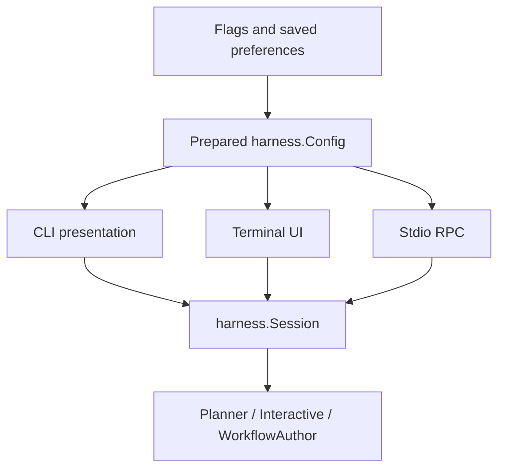

# Application command boundary review

Date: 2026-11-10. Reviewed baseline: `50b2a41`.
Status: baseline cleanup committed as `154f232`. The subsequent naming and
architecture cleanup is tracked in [the implementation record](internal-cleanup-plan.md).

## Current design

`cmd/gektor` resolves flags and preferences, owns launch resources and connects
frontends. It prepares one `harness.Config` before selecting CLI, TUI or RPC.

The prepared environment has identity, generation settings, backend facts,
permissions and deterministic rules. It has no frontend print callbacks.
Frontends supply event sinks and gate transports. RPC carries the whole config;
it replaces only per-request task, images, state location and transport callbacks.

The original directory had 16 production files and 16 test files. File count was
not the primary problem: duplicate configuration and execution paths were.
The bounded cleanup below repairs those boundaries without relocating the entire
command or introducing a generic application framework.

## Resolved findings

- RPC now preserves plan mode. A mocked write attempt is denied in the same way
  as CLI and the programmatic Session API.
- RPC retains identity, temperature, backend facts and deterministic check rules.
  Act-mode writes emit findings through the configured frontend event sink.
- The protocol server and its lifecycle tests moved from `cmd/gektor` to
  [`internal/agentrpc`](../../internal/agentrpc/agentrpc.go). The command only
  binds standard streams, task storage and the permission/audit transport.
- CLI run, resume, fork continuation and workflow authoring now use
  [`internal/harness.Session`](../../internal/harness/harness.go). It owns role selection,
  saved-question handling, budget continuation, mutation sweeps and reporting.
- Interrupted-run recovery uses `Session.Resume`, which answers a saved question.
  Forks and new user turns use `Session.Continue`, which closes outstanding calls
  and preserves the new instruction and images. The independent review caught
  and the regression test now covers the earlier conflation of these paths.
- CLI presentation observes session events; JSON output has one tool-result and
  one final outcome event. Obsolete independent event helpers were removed.
- Streaming uses the same session event path in JSON and RPC; TUI enables it
  automatically. JSON no longer needs a separate streaming-disable rule.
- TUI receives the prepared environment directly. The callback-clearing helper
  and tests requiring dummy print callbacks were removed.
- RPC rejects terminal mode, inline tasks and launch-time resume/fork/answer/image
  arguments instead of silently ignoring them. Request methods own those inputs.
- RPC clears active-run state before emitting the completed run response.

The common preparation function is
[`launchRunConfiguration`](../../cmd/gektor/agent_environment.go). The small
[RPC adapter](../../cmd/gektor/agent_stdio.go) and
[CLI adapter](../../cmd/gektor/agent_cli.go) consume that result. TUI retains its
screen state and terminal relaunch responsibilities.

## Remaining ownership rules

Read-only enforcement, permission checks, one active RPC run, gate cancellation
and cleanup remain explicit behavior. Symmetry means enforcing them in the
shared path, not relying on each frontend to recreate them.

Keep flag parsing, stdout/stderr selection, terminal presentation and resource
assembly in the command. Keep execution in Session and protocol framing in
agentrpc. `internal/app` remains provider/service composition; it cannot absorb
role/TUI orchestration without reversing dependencies.

This follows [Go's module layout guidance](https://go.dev/doc/modules/layout):
commands can have several files, while substantial supporting responsibilities
belong in internal packages. There is no file-count target.

## Packaging

[`cmd/release`](../../cmd/release/main.go) adapts arguments to
[`internal/release`](../../internal/release/release.go). Go owns manifest selection,
staging, archives and checksums. The Python packager and its tests were removed.
`build.cmd dist` stages Windows; `build.cmd release vX.Y.Z` builds both platforms
from a clean checkout. Packaging does not publish a GitHub release.

## Verification

[CLI/RPC parity tests](../../cmd/gektor/launch_parity_test.go) check actual model
requests, identity, temperature, plan-mode write denial, act-mode check findings,
JSON-only wire output and nonduplicated events. They also test the production
command-to-TUI configuration adapter and paused-history CLI forks with images.
[TUI launch tests](../../internal/tui/launch_test.go) use the same model constructor
and session factory as `tui.Run`, checking requests, images, streaming, plan
enforcement, findings, verification and saved answers without opening a terminal.
This covers both configuration handoffs; it does not claim terminal interaction
coverage. Session tests cover saved answers and resume prompts; existing tests
cover workflow authoring, forks, budget gates, TUI streaming, request overlap,
cancellation, EOF and event ordering.

Passed production-package tests and vet (`./cmd/... ./internal/...`), race tests
for harness, agentrpc, command and TUI packages, and all 44 dry eval probes. Windows
and Linux development distributions were rebuilt from the final implementation.

The local `go test ./...` walk encounters copied Go source under ignored historic
`eval/results/20261110-123946/inputs`. Production checks use `./cmd/...` and
`./internal/...`; those saved results have not been changed or removed.
No live model evals were launched for this refactor.
