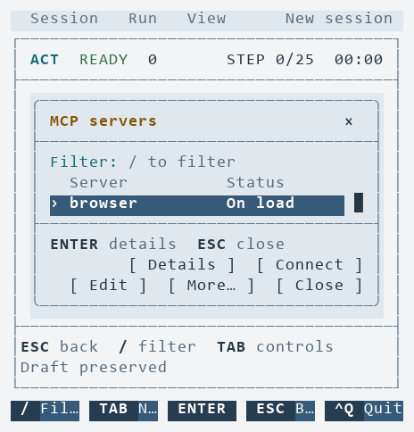
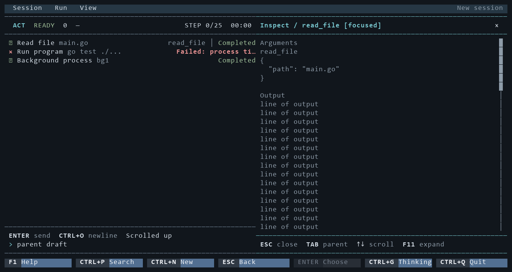

# GEKTOR project audit

Dated evidence and recommendations, 2026-11-20. This is a historical audit, not
a new architecture contract or a claim that every execution path was verified.
Production source was not changed.

Subsequent implementation is tracked in the
[remediation record](audit-remediation-2026-11-20.md). Findings below describe
the audited revision, not the updated working tree.

GEKTOR has a credible foundation for a local agent workbench with inspectable
execution and saved workflows. Its next investment should be correctness at
failure boundaries, readable task evidence, and a smaller integration surface.
More capability packages would add less value at this point.

The comparison used the supplied local checkouts:

| Project | Revision | Commit date |
|---|---|---|
| GEKTOR | `3802e3dac24079ce9bb3ea9855de684b54aefb27` | 2026-11-19 |
| Pi | `9fba660cf1caca0ade5bea72269352416e595a19` | 2026-10-02 |
| OpenCode | `c42ae0d56b6f86f8df39d451d6d2cfe6414b3928` | 2026-10-02 |

Pi and OpenCode were read at `D:/Projects/dev/_incubator/pi` and
`D:/Projects/dev/_incubator/opencode`. Their checkouts are older than this audit;
claims below describe those revisions. Current official pages were checked for
orientation, not used to silently substitute a different implementation.
No controlled three-product success-rate benchmark was performed.

Review covered architecture, representative ordinary and failure paths,
agent/tool/permission/process ownership, workflow durability, coding style,
TUI fixtures, reuse boundaries, tests, evaluation and release design. Independent
reviewers covered runtime, architecture and TUI. Earlier November audits were
checked so resolved findings would not be reported as new defects.

## Findings requiring fixes

Priority means remediation order, not a claim that every user encounters the bug.

| ID | Priority | Finding | Evidence |
|---|---|---|---|
| B1 | P1 | Time-budget closing loses model context and overwrites the archive's system message | Deterministic failing Go overlay probe |
| B2 | P2 | `check_background` can read another session's managed-process output | Deterministic failing Go overlay probe |
| B3 | P2 | Agent screen shutdown cancels but does not join active execution | Deterministic finalization-barrier probe failed 3/3; observed Windows cleanup failure |
| B4 | P2 | Markdown rendering removes literal asterisks and unmatched backticks | Executed rendering probe for user and answer text |
| B5 | P2 | First failed ChatGPT vision lookup remains cached until backend reconstruction | Traced discovery and tool construction paths; no live account fault injection |

**B1: preserve history through errors.** At
[run.go](../../internal/agent/run.go), lines 89 and 190–192, the caller replaces
`history` with the nil slice returned for an ordinary chat error. When this is
the working deadline, [finalizeRun](../../internal/agent/run_lifecycle.go)
passes it to [closeBudget](../../internal/agent/budget.go), which appends and
saves only its closing instruction. [captureHistory](../../internal/agent/state.go),
line 105, then replaces the saved archive's first message with that user-role
instruction. The closing model request also lacks the original task and work.

The probe used a stub that waits for the working deadline, then answers the
closing request. It observed context loss, archive-root replacement and the
same missing system message after loading the saved session from disk.
Existing budget tests assert tool-free closing and incomplete status, but not
the retained context. Preserve history on every error path. Test the closing
request, persisted system message, retained task, and resume after the deadline.
Do not add a replacement system prompt after the fact and conceal the lost input.

**B2: scope all agent process-log access.**
[Check.Run](../../internal/tools/background/background_tools.go), line 220,
discards its context and reads a process by ID. Wait and Stop check the output
store's scope. IDs are sequential, and the process manager is shared across
sessions within a launch. The probe read session A's marker from session B.
Centralize scoped lookup for agent tools; retain the operator inspector's
intentional launch-wide access. This is same-launch session leakage, not access
to arbitrary operating-system process output.

**B3: make Close mean execution has stopped.**
[startRun](../../internal/tui/agent/session.go), line 325, launches a goroutine.
[Model.Close](../../internal/tui/agent/agent.go), line 393, cancels it without
waiting. The root screen and `tui.Run` add no outer join, so launch cleanup can
close the workspace and integrations while the harness still observes files,
saves state, or closes diagnostics.

Normal Ctrl+Q waits through the UI's quit guard. Immediate Ctrl+C, terminal
errors, external cancellation and direct Close bypass that guard. The full
test run exposed this as `diagnostics.jsonl` still open during Windows TempDir
cleanup. Cancel the UI context first to unblock event publication, cancel work,
then join through final persistence and diagnostics cleanup. Joining after only
run cancellation can deadlock a full event queue. The workflow screen already
has the appropriate cancel-and-join pattern and a lifecycle test.
An independent stub held the cancelled run at a finalization barrier; Close
returned before that barrier was released in all three repetitions. See
[probe output](audit-2026-11-20/close-failures.txt).

**B4: render literal text faithfully.**
[renderSpans](../../internal/tui/agent/markdown.go), lines 296 and 302, consumes
markers without checking for a closing delimiter.
[isMdRole](../../internal/tui/agent/transcript_block_view.go), line 237, applies
this to user, answer and thinking text. Both user and answer probes produced:

| Input | Display |
|---|---|
| `inspect *.go` | `inspect .go` |
| `2 * 3` | `2  3` |
| An unmatched backtick | Backtick disappears |

The archive is intact; presentation is wrong. Existing glob coverage protects
tool arguments only. Use matched delimiter parsing or a suitable Markdown
parser. Include globs, arithmetic, escaped punctuation, streamed partial spans,
tables and copied text in regression checks.

**B5: cache successful capability facts, retry failed discovery.**
[app.go](../../internal/app/app.go), lines 132–137, puts both the value and error
of `SupportsVision` behind `sync.Once`. Startup inspection leaves vision unknown
on failure; [RefreshModelFacts](../../internal/app/discovery.go), lines 49–50,
skips non-local providers. Tool instances can therefore keep vision disabled
after a transient account-catalog failure. Explicit image inputs are still
forwarded on discovery error by [backend.go](../../internal/app/backend.go),
so this is not a universal image-input failure. Cache success and provide a
bounded retry/refresh path for unknown capability state.

**E1: strengthen evaluation of factual conclusions.** The live
`23-browser-unavailable` calibration correctly reported unavailable browser
verification, but invented an import-map resolution. The fixture maps the exact
key `modules` to `/lib/`; it does not map the prefix `modules/`. The answer
claimed `modules/calculator.js` resolves to `/lib/modules/calculator.js`, tested
that invented URL, then described its 404 as the browser failure's cause.
Under the [HTML import resolution rules](https://html.spec.whatwg.org/multipage/webappapis.html#resolve-an-imports-match),
the exact key does not match that bare specifier. Even a corrected `modules/`
prefix would yield `/lib/calculator.js`, not the claimed path.

The scorer failed this run only for taking eight steps instead of six; its
answer checks did not reject the false explanation. The retained
[model answer](audit-2026-11-20/browser-calibration-answer.txt) is evidence of
this one model/run, not proof of a universal harness behavior. Add deterministic
criteria for the specific causal claims the fixture is designed to expose.
Preserve artifact, tool-use, efficiency and answer-truth outcomes separately.

**E2: retain acceptance failure evidence and define eval exit semantics.**
[checkWorkspace](../../cmd/eval/main.go), line 840, retains only `firstLine(msg)`
from a failed check. The actual assertion output from `go_acceptance` is lost,
and the temporary workspace is then removed. The ledger calibration therefore
records only `acceptance failed: exit status 1`. Reconstructing the final library
from its recorded write/patch calls and running the trusted amount test exposed
the missing detail: it accepts invalid input `--1`. The model strips the first
sign and lets `strconv.Atoi` accept the second sign. See the preserved
[generated library](audit-2026-11-20/ledger-generated.go.txt) and
[acceptance replay](audit-2026-11-20/ledger-acceptance-replay.txt).

Retain bounded stdout/stderr, check identity, exit code and duration for each
acceptance check, with a reference from the summary. A short console summary
can remain. The eval process also exits zero after reporting scored failures
(`main.go:573–580`, observed 5/7 run); a CI wrapper must inspect results today.
Provide an explicit failure-threshold/exit policy before using live evals as a
release gate. Current CI validates definitions only, so it is not presently
claiming to enforce live-model success.

## Architecture, ownership and code style

Measured under `internal` and `cmd`: 558 production Go files, 80,048 physical
lines, 558 test files, 114 production packages. File count alone is not a reason
to split a package. `agent` has 31 production files but approximately 4,147 lines
and a coherent execution lifetime. Keep it cohesive.

The useful boundaries are already real:

- Agent defines narrow consumer interfaces and does not import tools, workspace
  implementations or UI. Its state is distinct from provider transport.
- Provider metadata and inspection are separate from request protocol adapters.
- Capability implementations are shared by agent and workflow adapters without
  importing either execution engine.
- Conversation archive and model context are separate. Compaction does not erase
  the underlying history.
- Workflow checkpoints, leases, artifact reservations and recovery rules have
  concrete implementations. Interrupted effects are not blindly retried.
- Import rules and documented convention tags are tested. CI covers Windows and
  Linux with race detection, eval-definition checks and vulnerability scanning.
- Versioned releases use committed input, verify archive contents and publish
  checksums. Current targets are Windows/Linux amd64.

The next structural changes should be small and specific:

| Change | Present cost | Proposed boundary |
|---|---|---|
| Return typed workflow results | `RunSource` returns JSON text; `withJob` reparses it and ignores decoding errors; TUI repeats the parse | `service.RunResult` with status, run ID, outputs and continuation facts; serialize in CLI/RPC/tool adapters |
| Consolidate observations | `roles.Env` and `agent.Config` each carry 13 `On*` callbacks, forwarded/wrapped in multiple places | One typed observation vocabulary; keep permission, verification and tool-context operations explicit |
| Require context in model-calling helpers | `maybeCompact` and `handleChatError` accept optional contexts and can fall back to Background | Required first `context.Context` argument; current production callers already supply one |
| Move workflow assembly to launch composition | `roles.configureTools` calls `app.NewWorkflow`, reaching broad capability assembly during role creation | Construct the concrete workflow service in the launch owner and supply it to roles/tools |
| Narrow the Agent screen's owners | 59 production files share execution, sessions, titles, MCP, evaluation and transcript state | Extract stateful responsibilities only when their lifetime and operations can become private |

Source anchors: [service.go:116,231](../../internal/workflow/service/service.go),
[jobs.go:99](../../internal/workflow/service/jobs.go),
[workflow/run.go:306](../../internal/tui/workflow/run.go),
[roles/env.go:25,194](../../internal/roles/env.go),
[observer.go:22](../../internal/harness/observer.go),
[roles/tools.go:33](../../internal/roles/tools.go).

Naming is generally domain-based: conversation, workspace, permission, process,
recipe, store and capability names help locate behavior. The weaker names are
wide construction surfaces such as `Env` and `Config`, whose cost is the amount
of unrelated state they expose. Renaming them without reducing responsibilities
would not help. Prefer concrete result types over generic `map[string]any` for
fixed application shapes; dynamic tool schemas and recipe payloads remain
legitimate dynamic data.

There are 753 production inline `if ... err := ...` initializers. They are
idiomatic Go but conflict with the requested house style. More useful cleanup
includes dense construction literals, optional contexts, repeated observer
forwarding, and comments explaining old incidents instead of current contracts.
Apply style when touching an owner. A mass formatting/naming pass would produce
large review churn while leaving the identified failure paths unchanged.

## Harness behavior and trust

The ordinary path is shared across CLI, TUI and RPC:

```text
launch composition -> harness.Session -> role -> Agent
  restore archive and capabilities
  accept steering and notifications
  prepare context and compact when needed
  request model; retain partial/interrupted output
  validate calls -> admit role -> resolve resources -> authorize
  execute read batches with exclusive barriers
  append results in model order -> checkpoint
  accept pending input -> verify if configured -> observe changes -> report
```

This is a sound flow. Malformed or interrupted calls are not executed as valid
tools. Changed files are observed independently of whether a tool claims
success. Steering respects tool-call/result ordering. Process groups, bounded
logs and pipe-drain limits account for real Windows/Unix behavior.

Several contracts need clearer product meaning:

- `completed` means the run ended without a runtime error; it does not prove the
  user's goal. Verification is optional and does not cause another repair turn.
  Show run status, verification status and user acceptance separately.
- Interactive checkpoints are best effort, while workflow persistence stops
  further execution on critical persistence errors. Do not describe both as the
  same durability guarantee. An explicit durable agent mode is a possible later
  feature, requiring its own recovery contract.
- Delegation is exclusive and children cannot delegate again. It is bounded
  subtask assistance, not concurrent isolated multi-agent execution. Introduce
  parallel work only with explicit workspace ownership and integration rules.
- Adjacent read tools spawn per-call goroutines without the workflow daemon's
  explicit concurrency cap. Add a bounded limit if broad tool batches become a
  real workload.
- Checkpoint model calls use `ChatWithRetry` directly rather than the ordinary
  `Agent.chat` observation path. Audit parent, child and checkpoint accounting
  before promising complete per-run request/cost totals.

The first calibration task advertised 30 tools. Tool schemas accounted for
3,796 of 5,012 estimated startup tokens (about 76%); the backend reported 5,426
actual prompt tokens. This is only about 4% of the configured 131K context, so
it is not evidence of context exhaustion. It is a useful experiment target for
local-model prefill and tool selection: compare a small default profile with
the current profile using the same tasks. Preserve permission descriptions and
discovery reliability; fewer schema tokens alone do not establish improvement.

## Comparison with Pi and OpenCode

These are implementation and product-surface comparisons, not measured rankings
of model intelligence or task success.

| Area | GEKTOR | Pi checkout | OpenCode checkout |
|---|---|---|---|
| Main advantage visible in code | Local provider handling, explicit tool policy, shared agent/workflow capabilities, durable recipes | Public composable agent/AI/TUI packages and extensive extension hooks | Rich coding interaction, terminal presentation and client/server surfaces |
| Local models | llama.cpp/Kobold inspection plus compatible API path | Direct llama.cpp router integration and compatible endpoint configuration | Compatible/local provider support; broad provider-oriented application |
| Extension surface | Skills, MCP/capability discovery, scripts/workflows, stdio RPC; Go runtime remains internal | Tools, events, commands, providers, UI and packages are documented public APIs | Backend/TUI plugin contracts and SDK; larger application ecosystem |
| Permissions | Built-in Plan/Act admission and resource/tool gates | README explicitly leaves OS resource restriction to external sandbox/container approaches | Built-in permission and question flows |
| Saved work | Archive/context separation, resume/fork, workflow records and continuation | Session tree with branch/fork/clone and preserved context | Session, fork/revert and change-review surfaces |
| Coding feedback | Project verification command; language-independent checks | Tools/extensions compose project-specific behavior | Existing application path integrates formatting and LSP diagnostics after edits |
| TUI reuse | Generic components have enforced import boundaries; all are internal | Published generic `pi-tui` package | Private OpenCode TUI application package, still imports core |
| Distribution | Go executable, current release targets Windows/Linux amd64 | Node-based packages and standalone release tooling, broader platforms | Broader CLI/desktop/web surfaces and native terminal stack |

Pi's local-model integration means “supports llama.cpp” alone is not a durable
reason to choose GEKTOR. Public reusable libraries are also a substantial Pi
advantage. Its current checkout is larger and more layered than the old image
of a four-tool loop; compare the actual packages rather than that reputation.

OpenCode's checkout is undergoing a substantial runtime migration. The existing
`packages/opencode/src/tool/edit.ts` and `write.ts` integrate formatting/LSP,
while `packages/core/src/tool/edit.ts` and `write.ts` still contain porting TODOs.
Do not assume every feature is at parity across both execution paths.

Similarly, `specs/tui-package.md` describes a no-core dependency target, but
`packages/tui/package.json` still declares `@opencode-ai/core`, and its app,
clipboard, theme and persistence code import core. Package extraction alone
does not make an application a generic toolkit.

Useful source trails in the comparison checkouts:

- Pi: `packages/agent/src/agent-loop.ts`, `packages/agent/README.md`,
  `packages/coding-agent/docs/extensions.md`, `models.md`, `sessions.md`, and
  `packages/tui/package.json`/`README.md`.
- OpenCode: `packages/tui/src/routes/session/index.tsx`,
  `packages/plugin/src/tui.ts`, `packages/tui/package.json`,
  `packages/cli/src/tui.ts`, and both old/new tool implementations above.
- Official orientation: [Pi repository](https://github.com/earendil-works/pi),
  [OpenCode repository](https://github.com/anomalyco/opencode),
  [OpenCode terminal guide](https://opencode.ai/docs/cli/tui/).

## Visual quality and a reusable TUI

GEKTOR has recognizable commander-style chrome, consistent palettes, light
themes, explicit state and inspectable tool output. Keep that identity. The
previous audit records a preference to retain the chrome; compact presentation
is a proposed option, not an already-approved redesign.

OpenCode's main visual advantage is hierarchy: neutral prose, quieter completed
tool lines, a clear composer, rich Markdown and syntax-aware code/diffs. The
local reference image is `packages/web/src/assets/lander/screenshot.png`;
the docs hero images are logo artwork. The reference is a checked-in screenshot,
not a newly exercised competitor session.

GEKTOR's fenced code is uniformly dim. Its Markdown subset omits links, nested
formatting and escaped table pipes, and wide tables wrap poorly. OpenCode's
session renderer uses Markdown syntax styles and a split/unified diff component;
Pi's generic Markdown component supports code highlighting and terminal links.
Literal fidelity, code/diff readability and links should precede new palettes.

Fresh settled GEKTOR fixtures show one server row in the 40×20 MCP dialog:



Header/status, modal title/filter/headings, hints/buttons, the underlying draft
area and footer all consume rows. The layout fits but exposes little working
content. At ordinary widths it is healthier. Design a focused overlay mode
where one active action strip explains the current task; measure visible content
rows at 40×20, 80×24 and 120×40 before accepting the change.

The inspector demonstrates the existing calmer palette and useful separation:



These PNGs are approximate font renderings of fresh ANSI test fixtures, not
native terminal screenshots. Mouse feel, terminal font fallback, assistive
technology, Linux rendering and live competitive sessions were not verified.
Some preview helpers do not settle root footer state; those artifacts are not
used as evidence of a footer bug.

The reusable Go candidate is a terminal workbench above Bubble Tea:

| Candidate | What it should own |
|---|---|
| cell/pane/popup | Cell geometry, framing, measured hit regions and scrolling |
| table | Stable row identity, selection, filtering and action availability |
| form/fields | Drafts, validation display, choices and stale async-result rejection |
| composer/completion/transcript | Editing, completion and viewport behavior |
| graph | Navigation and rendering of supplied graph data |
| screen controls | Menus, dialog presentation, focus and owner-handled intents |

Generic components already cannot import app packages. Controls copy values,
emit events and track dialog identity. Palette snapshots already permit separate
hosts. These are valuable foundations. The public-readiness obstacle is a broad
mutable API (`Controls.Dialog`, form/table state and embedded editor models),
along with some global theme convenience paths. For example, screen Title is
currently derived from Warning color despite their different semantic roles.

Before creating a module, build an unrelated list/detail/edit application using
these controls. It should need no roles, LLM, session, GEKTOR settings or workflow
services. Make dialog identity opaque and keep focus/offset/pending state private.
The owner should present data, receive intents, perform effects, and supply
results. Require independent themes, keyboard/mouse parity, async cancellation,
stale-result rejection, and small-terminal behavior in that second consumer.

After that proof, extract the controls with a small documented API, examples,
dependency policy and versioning. Keep Agent and Workflow screens in GEKTOR.
Use the existing RPC boundary for external agent integration before committing
to a large public Go harness API.

## Direction and acceptance gates

The strongest product proposition supported by the implementation is:
**do work with a local agent, inspect what actually happened, and turn repeatable
work into a reviewed recipe that can run again with recorded results.** This is
a recommended focus, not a claim that competing ecosystems cannot do it.

Build one convincing end-to-end journey around that proposition. A user should
see changed paths, verification commands/results, unverified claims, artifacts,
permissions, incomplete work and the correct continuation action in one run
receipt. The same facts should drive CLI, TUI, RPC and workflow presentation.

| Order | Work | Acceptance gate |
|---|---|---|
| 1 | Fix B1–B5 and add regression coverage | Deadline/resume preserves history; process reads respect session; Close joins; literal text survives rendering; failed discovery can recover |
| 2 | Typed workflow outcomes, explicit run receipts and preserved eval evidence | One internal status contract; UI never implies optional verification happened; acceptance assertions survive failed runs |
| 3 | Rich code/diff/Markdown and focused overlays | Visual fixtures for conversation, stream, failure, permission, queue, long history, diff and workflow in both theme families and three terminal sizes |
| 4 | Prove a smaller default tool/context profile | Repeated equal-model evals preserve success while measuring prompt tokens, first useful action, tool failures and recovery |
| 5 | Second consumer of TUI controls | Independent app imports no GEKTOR domain code and handles lifecycle without touching widget internals |
| 6 | Publish the proven component API and strengthen distribution | External example builds from a pinned version; supported platforms have release smoke coverage |

Avoid a whole-repository architecture rewrite. Avoid copying OpenCode's server,
plugin and desktop footprint without an actual consumer. Avoid publishing every
internal package. Add LSP integration only after deciding whether configured
verification is insufficient for the target coding workflow; it creates a
significant language-server lifecycle obligation.

For a fair future comparison, use the same model/quantization, server settings,
fixtures and acceptance checks in all three products, with at least three runs
per case. Include edits, failing-test repair, instructions, cancellation/resume,
long-context retrieval and unavailable tools. Record wall time, prompt/cache
counts, steps, tool failures and resulting artifacts. Separate product
configuration friction from task performance. Current evidence does not justify
claiming GEKTOR has a higher solve rate.

## Validation record

Host: Windows amd64, Go 1.26.11, Intel i5-12400F. All production source stayed at
the audited revision. The audit adds only this report and supporting evidence.

| Check | Result |
|---|---|
| `go vet ./...` | Pass |
| Initial `go test ./...` | Fail: two TUI deadline failures and Windows diagnostics-file cleanup failure under overlapping test/race/model load |
| Those three TUI tests, `-p 1 -count=3` | Pass in all isolated repetitions |
| `go test -p 1 ./...` | Pass; successful prior package results reused the Go cache, previously failing TUI packages reran |
| `go test -race ./...` | Pass; no race detector reports |
| `go run ./cmd/eval -dry` | All 45 probe definitions valid |
| Fresh TUI preview tests | Pass for reuse, modal cleanup, inspector themes, MCP layouts, queues and commander views |
| `govulncheck@v1.10.0 ./...` | No reachable vulnerabilities; one advisory in a required module's unimported package |
| Audit regression probes B1/B2/B3 | Fail as expected on current code |
| Audit literal-render probe B4 | Executed successfully and logged incorrect renderings; its PASS is not a correctness verdict |

The vulnerability advisory is `GO-2026-5932` for `golang.org/x/crypto/openpgp`.
The scan reported no affected imported packages or reachable symbols. This is
not reported as an exploitable GEKTOR vulnerability.

The initial failures were
`TestNativeConsoleMultilinePasteWaitsForExplicitEnter`,
`TestCommonMenusHaveNoRedirects` and
`TestTUIProductionFactoryPreservesSavedAnswer`. The latter two have short fixed
deadlines; they passed on isolated reruns and under race instrumentation. Their
initial failures remain evidence of test sensitivity to contention. The shutdown
defect is independently reproduced and should not be dismissed as a timeout.

The existing 500-block transcript benchmark measured approximately 0.211 ms and
113 KB allocated per unchanged refresh, and 0.341 ms and 126 KB per growing
refresh. This does not suggest a need to replace the renderer for that workload.
Other tests and the model were running concurrently; these are diagnostic
samples, not stable release baselines or comparisons against other products.

Reproduction sources are preserved as `.go.txt`, outside ordinary test discovery.
From the repository root, run:

```powershell
pwsh -NoProfile -File docs/internal/audit-2026-11-20/reproduce.ps1
```

The script creates a temporary Go overlay without changing production files.
It exits nonzero on the audited revision because the invariant probes fail.
The Markdown probe prints its observed strings. Evidence includes
[harness failures](audit-2026-11-20/harness-failures.txt),
[shutdown failures](audit-2026-11-20/close-failures.txt) and
[render observations](audit-2026-11-20/markdown-observations.txt).
The combined rerun, including the disk-persistence assertion, is retained in
[reproduction output](audit-2026-11-20/reproduction-output.txt).
These are audit probes, not completed fixes.

The local-model calibration uses Ornith 1.5 35B A3B Q5_K_M from the supplied
llama.cpp endpoint, context 131072, response limit 8192, jobs 1, one core-suite
repeat. Source, binary, prompts and fixture hashes are in the run metadata.
One repeat measures calibration only. Test/build load overlapped the run, so
latencies are not a clean model-speed benchmark.

| Scenario | Outcome | Steps | Seconds |
|---|---|---:|---:|
| Exact patch | Pass | 4 | 36.0 |
| Search then edit | Pass | 4 | 36.4 |
| Managed server lifecycle | Pass | 5 | 141.7 |
| Injected overflow recovery | Pass | 3 | 6.0 |
| Browser unavailable | Fail: 8 steps, limit 6; additional unscored false explanation | 8 | 79.5 |
| Nested skills | Pass | 5 | 24.1 |
| Go ledger repair | Fail: acceptance test and 25 steps, limit 16 | 25 | 605.4 |

Total: **5/7**, no skipped or infrastructure-error runs. Median 36.4 seconds and
5 steps; four tool failures. The ledger model reported completion and passing
own tests, but independent acceptance rejected `--1`. This is concrete evidence
for keeping model completion and task correctness distinct. It does not isolate
the contribution of the model from the harness or establish a competitor rank.

Command used:

```text
go run ./cmd/eval -suite core -runs 1 -jobs 1 -backend http://127.0.0.1:9931 -require-model Ornith -out eval/results/audit-20261120-core
```

Preserved [metadata](audit-2026-11-20/eval-meta.json),
[summary](audit-2026-11-20/eval-summary.json) and
[individual results](audit-2026-11-20/eval-results.jsonl) identify the run.
Full request/response traces remain under
`eval/results/audit-20261120-core/20261120-081251/` in this checkout.
The [ledger final answer](audit-2026-11-20/ledger-calibration-answer.txt) preserves
the completion claim. The acceptance replay used the recorded final library
and trusted `TestAcceptanceAmounts`, without executing recorded shell commands.

The audit report's local links resolve. The website documentation checker passed
for 71 files/35 published articles; this internal report is not a public article.
