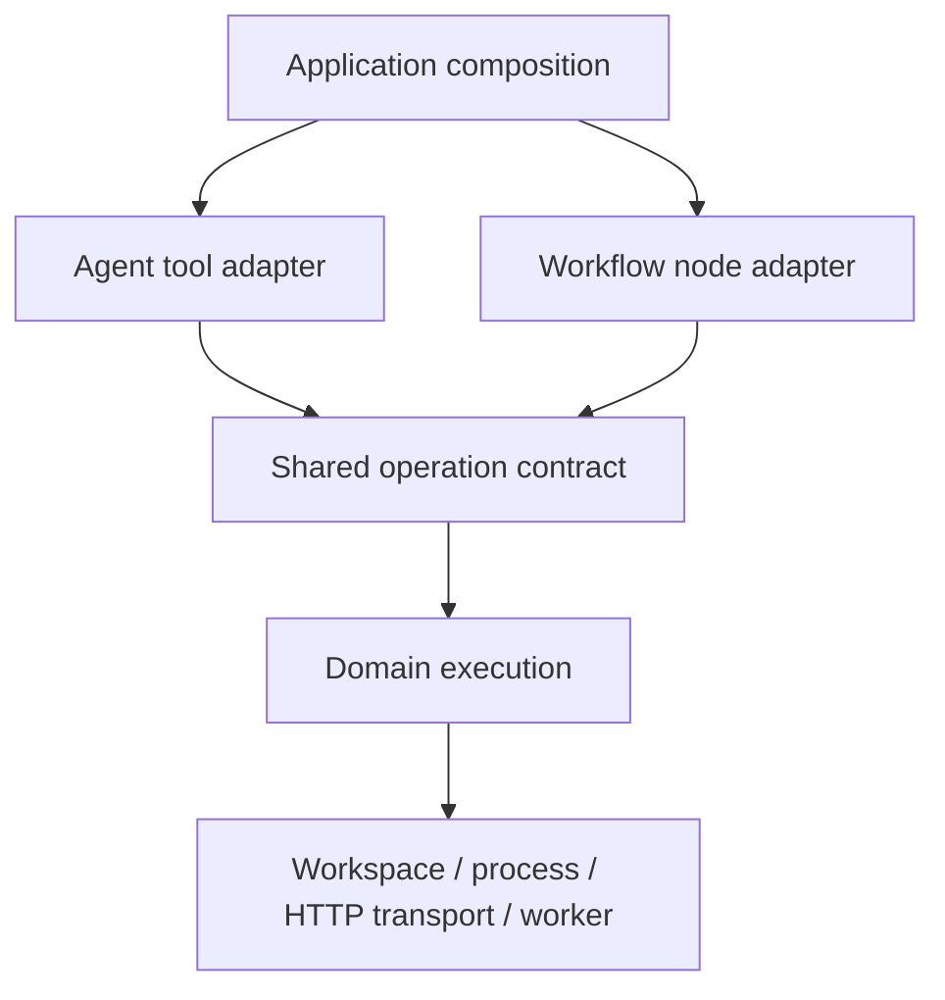

# Tool, node and capability review

Date: 2026-11-10. Reviewed baseline: `244fac29bc0840772a9a75f4fe299e3adfe5da45`.
Status: review and accepted cleanup complete. Verification is recorded below.
This document describes the current design and the decisions made from the review.

## Decision

Keep the established pattern: concrete domain services, explicit composition,
small consumer-owned interfaces, shared operation contracts and thin frontend
adapters. The review identified one incorrect owner for already shared record
operations and a boundary-enforcement gap. Both are resolved. Retry policy is now
explicit in shared contracts instead of inferred from read-only metadata.

There is one current implementation of each operation. No compatibility facade,
forwarding package or parallel replacement implementation was introduced.

## Current boundaries

Agent exposure packages own discovery, activation, instructions and availability.
Domain capabilities own reusable task execution. Those are different concerns:
an exposure package may include session or workflow-management tools without
needing a corresponding domain capability for every tool.

The contract owns JSON schemas, descriptions, decoding, permission resources and
operation policy. Domain execution owns validation, bounds and cleanup. Frontends
own permissions and lifetime. Nodes add versions, reference validation and result
validation.

Documents, files, images, media and social provide 21 shared operations under
`internal/capabilities`. Application records add two operations shared in
[`workflow/records`](../../internal/workflow/records/records.go). Records
belong to the workflow user store, so this package uses that existing storage
boundary directly. Its location is deliberate, not a migration stage toward a
new persistence abstraction.

Evidence: [development pattern](../development/capabilities.md),
[Agent contract](../../internal/agent/tool.go),
[node descriptor](../../internal/workflow/node.go),
[Agent composition](../../internal/tools/tools.go),
[workflow composition](../../internal/app/workflow.go).

## Resolved findings

### Shared records have a neutral owner

Previously the Agent record adapter imported execution from the workflow node
adapter package. Resource derivation was duplicated and the descriptions had
already diverged around `allow_missing`.

The shared operation now owns names, descriptions, input/output schemas,
read-only and retry declarations, execution and resource derivation. Both
[Agent](../../internal/workflow/agenttools/records.go) and
[node](../../internal/workflow/nodes/record/record.go) adapters delegate to
it. Permission routing calls the same resource helper. The former implementation
and test files were moved out of the node package; no aliases remain there.

Store paths, registered schemas, optimistic revisions and workspace ownership
retain their behavior. Tests cover cross-frontend state visibility, missing
records, stale revisions, cancellation and workspace isolation.

### Dependency rules enforce adapter ownership

The [package-layer check](../../internal/conventions/conventions_test.go) now
rejects Agent tool adapters importing workflow node adapters, including nested
adapter packages. Shared records and its node adapter also have explicit import
allowlists. Application composition remains responsible for assembling frontends.

### Retry policy is explicit

Every shared capability contract declares `RetrySafe` independently of
`ReadOnly`. Nodes consume that policy. Record writes remain non-retryable because
a successful commit followed by a lost response cannot be safely repeated with
the same expected revision.

[Contract parity tests](../../internal/tools/capabilities_integration_test.go) now
cover all 23 shared operations and compare descriptions, input schemas and
permission resources. They check expected concurrency, read-only and retry values
separately. The policies of the existing operations have not changed.

[Runtime permission coverage](../../internal/roles/records_test.go) exercises an
actual Agent dispatcher call and a workflow run against the same denied record
resource, then verifies neither call created the record.

## Deliberate differences

The image service consumes a small `Inputs` interface. Agent adapters resolve
session attachment grants; workflow nodes use explicit workspace inputs. This is
a useful boundary rather than an inconsistency.

Agent commands and bounded workflow/media processes have different output
policies: streaming combined logs and spill storage versus separate bounded
streams and run artifacts. Both already reuse process-group cleanup and
credential scrubbing. The review found no reason to replace those policies or
add a new process capability. Share additional launch mechanics only when a
concrete change calls for it.

Session questions, attachment grants, history and background jobs retain session
ownership. Scheduling, reviews, nested workflows and run artifacts retain workflow
ownership. MCP and executable tools remain provider adapters with explicit
transport, credentials and lifecycle requirements.

## Rules for future operations

Structured HTTP, workspace editing and isolated transforms do not need another
capability package merely for naming symmetry. When adding a second frontend,
extract one shared contract and execution boundary first:

- HTTP must retain origin-bound credentials, no redirects, response bounds,
  status-as-data behavior and disabled automatic retries. Web fetching has
  different redirect and presentation semantics.
- Workspace editing must retain rooted access, encoding/newline handling,
  locking and permissions. Immutable workflow artifacts have different ownership.
- Structured transforms must reuse the existing isolated
  [script execution service](../../internal/workflow/script/worker.go).

These are extension rules, not outstanding work. There is no universal Capability
interface, generic repository layer or broad migration required by this review.
The current use of concrete services and consumer-defined interfaces agrees with
[Go interface guidance](https://go.dev/wiki/CodeReviewComments#interfaces).

## Verification

Passed `go test -p 1 ./internal/... ./cmd/...`, targeted `go vet -p 1` across
the changed packages, Go formatting checks and `git diff --check`.
The tests cover services, frontends, role integration and import boundaries.
New behavior checks are in
[record adapter tests](../../internal/workflow/agenttools/records_test.go),
[shared record tests](../../internal/workflow/records/operation_test.go) and the
permission/parity tests linked above. No live model evals are required for this
ownership refactor; no model eval was launched.
